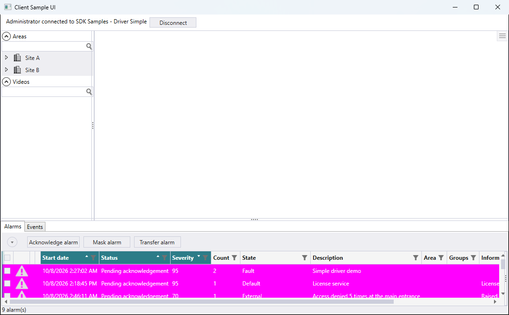

# ClientAdvanced — Your own window with AppVision UI controls

**Used for:** building a custom operator application (dashboard, dedicated console, kiosk) that reuses the
ready-made WPF controls of the AppVision client — area tree, camera list, document container, alarm list, event
list — instead of re-developing them.

**Audience:** C# / WPF developers who completed [ClientSimple](../ClientSimple/README.md).



Compared to ClientSimple, this sample:

- connects the **`Sdk.Server` singleton**, the server instance that every AppVision UI control reads;
- loads the AppVision colour palette with **`RColor.Load()`**, the control styles and the **labels** of `appClient.exe`;
- places **AppVision controls** in its own XAML: `AreaControl`, `CamerasControl`, `Container`, `AlarmControl`,
  `EventControl`;
- asks for the **initial values** (`StartNotifications(true, ...)`) and asks the controls to **reload**
  (`OnUpdateContent()`) once the session is open;
- reads a server **option** with `GetOption()`;
- persists the host and user name (never the password) and **closes the session** when the window closes.

**References** (AppVision `Bin` folder): `appSDK.dll`, `appData.dll`, `appCommon.dll`, `appUI.dll` (area, alarm and
event controls, `RColor`), `appVideo.dll` (`CamerasControl`), `appClient.exe` (`Container`, `Themes/Generic.xaml`),
`appSyn.dll`. **Output:** `ClientAdvanced.exe` — standalone WPF application.

**Documentation:** *Getting started* in the API help served by your server,
`http://<server>/doccsharp/html/4d97183d-f664-4102-9eb7-e35df2a99dd8.htm` (URL relative to your server, see
[Documentation](../README.md#documentation)). The controls of `appClient.exe` (`Container`...) are not described in
the API help: this README is their documentation.

---

## How it works

| File | Role |
|---|---|
| `App.xaml` | Merges `/appClient;component/Themes/Generic.xaml` (styles of the AppVision controls) |
| `MainWindow.xaml` | Login bar, AppVision controls |
| `MainWindow.xaml.cs` | Theme, connection, subscription, disconnection |
| `Properties\Settings.settings` | Host and user name, persisted per Windows user |

### 1. `Sdk.Server` singleton

`Sdk.Server` is a static `AppServer` instance shared by the whole process. The AppVision controls take their data
from it: connect it, log in and load the database **before** they need data. Inside the AppVision client, it is
already connected (see the WpfControl samples): never call `Open()` / `Login()` there.

```csharp
Sdk.Server.SynchronizeUI = true;           // SDK events on the UI thread, as the controls expect
Sdk.Server.Open("localhost");
Sdk.Server.Login("ADM", password);
await Sdk.Server.LoadDatabase(true);
Sdk.Server.AddFilterNotifications("All");
Sdk.Server.StartNotifications(true, false); // initial values, polling mode

// the cache is now loaded: ask the controls to reload
areas.OnUpdateContent(); cameras.OnUpdateContent(); alarms.OnUpdateContent(); events.OnUpdateContent();
```

The AppVision controls reload their content by themselves on `UserManager.UserChanged`, and on
`ControllerManager.StateChanged` **only when the server goes from active to inactive or back**. When you connect by
code, both happen during `Login`: the controls reload at that moment, while `LoadDatabase` has not filled the cache
yet, and show empty lists. The later events (`StateChanged` raised by `AddFilterNotifications` and the initial
values) do not change the active state, so they do not reload them. Call their public `OnUpdateContent()` once the
cache is loaded, as the AppVision client does after `StartNotifications`.

**Labels.** The controls display translated labels (`RT.Get("Alarm.acknowledge")`). Load the label file shipped
in `appClient.exe` **before** `InitializeComponent()`:

```csharp
var labels = Application.GetResourceStream(new Uri("/appClient;component/Resources/Applab.txt", UriKind.Relative));
using (labels.Stream) RT.Load(labels.Stream, "en");    // or "fr", "de"...
```

### 2. AppVision controls in XAML

```xml
xmlns:app="http://prysm.fr/AppVision"     <!-- appUI.dll, appClient.exe -->
xmlns:video="http://prysm.fr/AppVideo"    <!-- appVideo.dll -->

<app:AreaControl/>          <!-- area tree with states -->
<video:CamerasControl/>     <!-- camera list -->
<app:Container AllowDrop="True"/>  <!-- document area of the AppVision client -->
<app:AlarmControl/>         <!-- current alarms -->
<app:EventControl/>         <!-- live events -->
```

Outside the AppVision client, `Sdk.Client` is `null`: features that drive the client itself (opening synoptics
compiled by the configurator, workspaces, client scripts) are not available in this window.

### 3. `RColor.Load(lightTheme)`

Called in the constructor, before `InitializeComponent()`, so that the `{app:RColor ...}` resources used by the
controls exist when the XAML is loaded: `true` = light palette, `false` = dark palette.

### 4. `StartNotifications(sendInitialValues, useWebService)`

| Parameter | `true` | `false` |
|---|---|---|
| `sendInitialValues` | The server first sends the current states (variables, protocols, current alarms) | Only later changes |
| `useWebService` | The server pushes notifications to an HTTP listener opened by the SDK on this machine | The SDK polls the server (used here) |

### 5. `GetOption(name)` / `GetLicenseInfo(name)`

```csharp
string desc = Sdk.Server.GetOption("App.Main.ProjectDescription"); // configuration option
string sn   = Sdk.Server.GetLicenseInfo("SN");                      // license field
```

### 6. Clean disconnect

Unsubscribe your handlers, then call `Close()`; it stops the notifications and logs out. The sample does it on
**Disconnect**, when the connection fails half-way, and when the window closes.

```csharp
Sdk.Server.AlarmManager.AlarmChanged -= OnAlarmChanged;
Sdk.Server.Close();
```

---

## Build and run

1. Build the project. The output goes to `bin\Debug\` (or `bin\Release\`) in the project folder; the AppVision
   assemblies are copied next to the exe.
2. Run `ClientAdvanced.exe`, check host / user / password (default `http://localhost:80/`, `ADM`, `123`) and click
   **Connect**.
3. The area tree, the camera list, the alarms and the events fill in. Trigger an alarm (for example with
   [DriverSimple](../DriverSimple/README.md)) to see it in the *Alarms* tab. Drag a camera from *Videos* onto the
   right-hand container to display it.

---

## Troubleshooting

| Symptom | Cause |
|---|---|
| Startup crash *Could not load file or assembly 'appClient'* (or appUI, Telerik...) | The AppVision assemblies are not next to the exe: keep *Copy Local* on the references. The Telerik theme and document assemblies loaded by the `appClient` styles through pack URIs (`Telerik.Windows.Themes.VisualStudio2013`, `Telerik.Windows.Documents`, `...RibbonView`, `...RichTextBoxUI`) are not detected by the build: they are declared as references in the `.csproj` for that reason. |
| Controls stay empty after Connect | `OnUpdateContent()` not called after the connection, the database was not loaded, or the user's profile filters the areas/groups. |
| Buttons show keys such as *Alarm.acknowledge* | The labels were not loaded (`RT.Load`) before `InitializeComponent()`. |
| Colours do not match the AppVision client | `RColor.Load(true)` loads the default light palette, not the colours customised in the configuration. |
| `The calling thread cannot access this object` | An SDK event handler touches the UI from a background thread: set `SynchronizeUI` or use the `Dispatcher`. |
| Login refused | Wrong credentials, user locked, or a non-standard authentication method on the server. |

---

## Learning path

```
ClientSimple  ->  ClientAdvanced                 ->  WpfControlSimple / WpfControlAdvanced
Standalone        Sdk.Server, AppVision controls      Your controls hosted by the AppVision client
```
