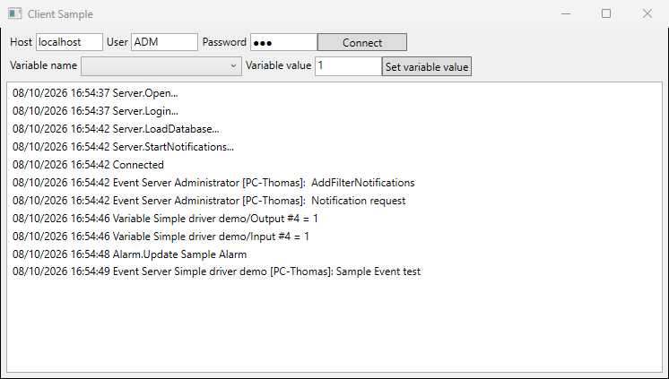

# ClientSimple — Simple AppVision client

**Used for:** learning the minimal sequence of a standalone application that connects to an AppVision server,
receives live notifications and writes a variable: a monitoring tool, a gateway to another system, a test bench.

**Audience:** C# developers new to the AppVision SDK. No AppVision client or configurator knowledge is needed
beyond a user name and a password.



The window connects with a user account, then lists every notification it receives:

| Stream | Event | Raised when |
|---|---|---|
| Variables | `VariableManager.StateChanged` | A variable changes value, quality or alarm state |
| Alarms | `AlarmManager.AlarmChanged` | An alarm is raised, acknowledged, ended, closed |
| Events | `EventManager.EventChanged` | An event is added to the event log (login, command, driver start...) |

The second row of the window writes a value into any variable.

**References:** `appSDK.dll`, `appData.dll`, `appCommon.dll` (from the AppVision `Bin` folder).
**Output:** `ClientSimple.exe` — standalone WPF application.

---

## How it works

| File | Role |
|---|---|
| `MainWindow.xaml.cs` | Connection, subscriptions, read/set variable, disconnection |

### 1. Connection sequence

```csharp
var server = new AppServer { SynchronizeUI = true };
server.VariableManager.StateChanged += OnStateChanged;  // subscribe before starting the notifications
server.Open("localhost");                     // open a session: host name or IP, optional port or https://
server.Login("ADM", "123");                   // log in with an AppVision user (throws if refused)
await server.LoadDatabase(true);              // download the configuration into the local cache
server.AddFilterNotifications("All");         // choose what the server notifies
server.StartNotifications(false, false);      // start receiving the notifications
```

`AppServer` is the client-side entry point of the SDK. Drivers use `AppServerForDriver` instead (see
[DriverSimple](../DriverSimple/README.md)).

### 2. Notification filters

`AddFilterNotifications` can be called several times; the filters add up.

| Filter | Receives |
|---|---|
| `"All"` | Everything (fine for a demo, too much for a large site) |
| `"$V.CR1.*"`, `"$V.A.*.Cmd\|$V.B.*.Cmd"` | Variables matching the patterns |
| `"$A.Area1\|$A.Area2"` / `"$G.Group1"` | Objects of these areas / groups |
| `"NotificationType=VariableState\|AlarmRow\|EventRow"` | Only these kinds of notification (also `AreaState`, `GroupState`, `ProtocolState`) |
| `"VariableType=Reader\|Enum"` | Variables of these types |

### 3. `StartNotifications(sendInitialValues, useWebService)`

| Parameter | `true` | `false` |
|---|---|---|
| `sendInitialValues` | The server first sends the current state of everything that matches the filters | Only later changes are notified |
| `useWebService` | The SDK opens an HTTP listener on this machine and the server pushes the notifications to it (port to open in the firewall) | The SDK polls the server (simplest, used here) |

### 4. Threading

Set `SynchronizeUI = true` (as the AppVision client does) so that the SDK raises its events on the WPF UI
thread when it polls the server. In web service mode (`useWebService = true`) the events arrive on a background
thread whatever this setting: this sample's `Trace()` method therefore goes back to the UI thread with
`Dispatcher.InvokeAsync` before touching the list box. Do the same in your handlers.

### 5. Reading and writing values

```csharp
var states = server.VariableManager.GetStates();        // snapshot of all values, from the local cache
server.VariableManager.Set("Building.Room1.Setpoint", "21.5");
```

`Set` sends a command: the server applies it, or forwards it to the driver of the variable, according to the
variable configuration. Values are strings converted by the server: Bool `1`/`0`, Enum = state number,
Double with `.` as decimal separator. The user's profile must allow commands on the variable.

### 6. Disconnection

`Close()` stops the notifications, logs the user out and closes the session. Call it when the window closes:
otherwise the session stays open on the server until it times out.

---

## Build and run

1. Build the project (Debug or Release). The output goes to `bin\Debug\` or `bin\Release\` in the project
   folder; the AppVision DLLs are copied next to the exe.
2. Run `ClientSimple.exe`.
3. Enter the server address (`localhost`, `192.168.0.10`, `https://myserver`...), user and password,
   then click **Connect**. Default account of a new configuration: `ADM` / `123`.
4. Change a variable in the AppVision client or with a driver sample: the change is listed. Select a variable,
   type a value and click **Set variable value**.

---

## Troubleshooting

| Symptom | Cause |
|---|---|
| `Exception: ... unable to connect` on Open | Server not started, wrong address or port, or firewall. Try the address in a browser: `http://host/AppVisionService.svc/Hello`. |
| Login refused | Wrong user or password, user locked, or the server uses another authentication method (AD, two-factor...). |
| The variable list is empty | The configuration has no variables, or the user's profile filters them (areas/groups). |
| Nothing is listed after Connect | Nothing changes on the server: start a driver or change a value in the client. |
| `Set` has no effect | The variable is driven by a driver that is stopped, or the profile does not allow commands. |

**Debugging:** set breakpoints in the `StateChanged` / `AlarmChanged` / `EventChanged` handlers. The SDK
logs its calls (Open, Login, StartNotifications...) in `C:\ProgramData\AppVision 4\LogFiles\<year>\`, in a
sub-folder named after the application (default location).

---

## Learning path

```
ClientSimple  ->  ClientAdvanced                        ->  WpfControlSimple / WpfControlAdvanced
Standalone        Sdk.Server singleton, AppVision UI        Controls hosted by the AppVision client
                  controls in your own window
```
