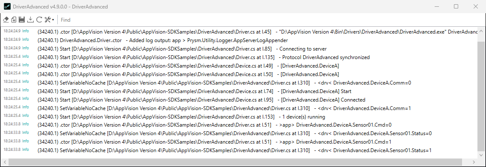

# DriverAdvanced — Template for a production driver

**Used for:** starting a real AppVision driver (connector) for an external system: a security or building
controller, a field device or a standard protocol (MQTT, OPC UA, BACnet, Modbus, SIA...). The project gives the
structure used by the Prysm drivers: one `Device` object per linked variable, value cache, alarms on errors,
logging window and log file, deployment in `Bin\Drivers\<name>\`.

**Audience:** C# developers who know [DriverMinimal](../DriverMinimal/README.md) and
[DriverSimple](../DriverSimple/README.md), and who deliver a driver to AppVision sites.

**Output:** `DriverAdvanced.exe` in `..\..\..\Bin\Drivers\DriverAdvanced\` (with the repository in
`AppVision 4\Public\AppVision-SDKSamples`, that is the AppVision `Bin\Drivers\DriverAdvanced` folder).

| Assembly (*Copy Local = False*) | Namespace | Used for |
|---|---|---|
| `appSDK.dll` | `Prysm.AppVision.SDK` | `AppServerForDriver` and its managers |
| `appData.dll` | `Prysm.AppVision.Data` | `VariableRow`, `VariableState`, `ProtocolRow`, `CommStatus` |
| `appCommon.dll` | `Prysm.AppVision.Common` | `Helper` (parameters, addresses), `RT` (labels), `HidePasswords` |
| `App.Logger.dll` | `Prysm.Logger` | `Trace`, `LogLevel` |
| `App.Utility.dll` | `Prysm.Utility.Logger`, `Prysm.Utility.Views` | `AppServerLogAppender`, `LoggerBox` |

---

## How it works

```
AppVision server
  │ starts  Bin\Drivers\DriverAdvanced\DriverAdvanced.exe  <protocol>[@host] [-password=...]
  ▼
App.xaml.cs      lifecycle: window, Closed / Restart events, unhandled exceptions
  └─ Driver.cs   connection, protocol settings, devices, filters, cache, alarms, Download / Refresh
       └─ Device.cs (one per variable whose Source is $P.<protocol>)
                 connection to the external device, commands, Comm status
```

1. **Startup** (`App.OnStartup` → `Driver.Start`): `Open`, `Login`, warranty check, `GetVariablesByProtocol()`,
   notification filters, `StartNotifications`, `ProtocolSynchronized`, then one `Device` per linked variable.
   A device that fails to start raises an alarm, the others keep running.
2. **Values from the device** go through `Driver.SetVariable(name, value)`: the value is sent only if it changed since
   the last call (cache), which saves server load and history. `SetVariableNoCache` forces the sending.
3. **Commands from AppVision**: the filter `$V.<device>.*` plus `Variable.StateType=1` delivers only the variables of
   the devices that have the **Command** flag. Each `Device.VariableChanged` keeps the variables of its own device.
4. **Communication status**: each device writes `<device>.Comm` with the `CommStatus` values.
5. **Errors**: `Driver.AddAlarm(exception, variableRow)` logs the exception and raises an alarm (severity 10) in the
   area and groups of the variable; protocol-level errors pass `null`.
6. **Stop**: `ControllerManager.Closed` (AppVision stops the protocol) or `ControllerManager.Restart` (the SDK lost
   the connection to the server) → `Driver.Stop()` (devices set `Comm` to Disconnected, then `AppServer.Close()`)
   and the window closes. The driver does not relaunch itself: AppVision restarts protocols itself (close, then new
   process) and relaunches the *Autostart* protocols whose driver stopped answering.

### Comm variable

| `CommStatus` (`appData.dll`) | Value | Meaning |
|---|---|---|
| `Unknown` | 0 | Not determined yet (set when the device object is created) |
| `Connected` | 1 | Device reachable |
| `Disconnected` | 2 | Stopped on purpose (driver stopped) |
| `Fault` | 3 | Communication error |
| `Downloading` | 4 | Configuration being downloaded to the device |

Declare `<device>.Comm` as an **Enum** (or Integer) variable with these states, **without** the *Command* flag: it is
written by the driver, not by the operators.

### Settings of the protocol and of the devices

`AppServer.CurrentProtocol` (`ProtocolRow`) holds the settings shared by all devices; each device variable
(`VariableRow`) holds its own. The commented lines of `Driver.Start` and of the `Device` constructor read them:

| Configurator field | Protocol (`CurrentProtocol`) | Device variable (`VariableRow`) |
|---|---|---|
| Address | `.Address` → `Helper.ParseEndPoint(address, defaultPort)` / `Helper.ParseUri(...)` | `.Address` |
| Timeout, Retries | `.Timeout`, `.MaxRetry` | — |
| Parameters (`Name=Value` lines) | `Helper.GetParameter("Param1", .Parameters, "default")`, `Helper.GetParameter<int>(...)` | `.FullParameters` |
| Log level | `.LogLevel` (0 Error, 1 Information, 2 Debug) | — |

Parameters may contain passwords: log them through `HidePasswords()` as the sample does.

`Device.variableUpdated` is called when a variable of the device is modified in the configurator while the driver
runs (`VariableManager.RowUpdated`): reconnect there if the address or the parameters changed.

### Logging

`Trace.Info / Trace.Error` (`App.Logger`) write to two appenders:

- `LoggerBox`, the list of the window (right-click: log level, maximum number of lines, saved in the user settings);
- `AppServerLogAppender`, which writes through `AppServer.Log()` to the driver log file
  `C:\ProgramData\AppVision 4\LogFiles\<year>\<product>\<protocol>_<yyMM>.log`, filtered by the *Log level* of the
  protocol.

### Download and Refresh

| Event | Raised when | Typical action |
|---|---|---|
| `AppServer.Download(varNames, parameter)` | AppVision asks to download data to controllers (`varNames`: comma-separated device variables; `parameter` e.g. `Holidays,Timetables,Rights`) | send timetables, profiles, badges (see [DriverAppControl](../DriverAppControl/README.md)) |
| `AppServer.Refresh(parameter)` | AppVision asks for a resynchronisation | read all states again, `SetVariableNoCache` |

For testing, the buttons of the window call them too: `App.OnStartup` binds the WPF commands `Refresh` (also *F5*)
and `CorrectionList` of the `LoggerBox` to `Driver.Refresh("")` and `Driver.Download("", "")`.

### Warranty check

`AppServer.CheckWarrantyDate(BuildInfo.Date)` refuses to run a driver built after the end of the AppVision warranty
of the site (it always passes on demo and internal licenses). `BuildInfo.cs` is generated at each build by the T4
template `BuildInfo.tt` (`TransformOnBuild` in the `.csproj`): do not edit it.

### Deployment layout

The build output is `Bin\Drivers\DriverAdvanced\DriverAdvanced.exe`. The AppVision DLLs are referenced with
*Copy Local = False* and are **not** copied: the static constructor of `App` installs an `AssemblyResolve` handler that
loads them from the parent folders (`..` then `..\..`, i.e. `Bin`). The handler must be registered before any
AppVision type is used, hence the static constructor.

---

## Step 1 — Configure AppVision

### Option A — The configuration provided with the sample

The `Configuration` folder is a complete AppVision configuration (`Param` and `Histo` databases, synoptics):

| Object | Content |
|---|---|
| Protocol | `DriverAdvanced`, *Manager* `Drivers\DriverAdvanced\DriverAdvanced.exe` |
| Device | `DriverAdvanced.DeviceA`, *Source* `$P.DriverAdvanced` |
| Children | `DeviceA.Comm` (Enum, connection status), `DeviceA.Sensor01`, `DeviceA.Sensor01.Status` (Enum), `DeviceA.Sensor01.Cmd` (Command) |
| Home page | a *Sensor* symbol: click = toggles `Sensor01.Cmd`, colour = `Sensor01.Status` (grey Normal, red Alarm), right-click = clear / acknowledge |

It also holds objects of other samples (other protocols and variables): ignore them.

1. **Copy** the `Configuration` folder out of the repository, for example to
   `AppVision 4\Configurations\DriverAdvanced` (the server upgrades and writes the databases).
2. In the **server window** (appServer), click **...** next to *Configuration*, then **Browse**, and select the copied
   folder (it must contain `Param` and `Histo`). The server restarts on it. Holding **Shift** while the server
   starts also opens this choice.
3. If a synoptic reports a compilation error, **generate** the client configuration.

The sample contains a small simulation in `Device.VariableChanged`: when a `<x>.Cmd` command arrives, it writes the
same value to `<x>.Status`. Clicking the sensor of the home page therefore changes its colour, provided that the
driver runs. Remove this block when you implement your device.

### Option B — By hand

```
Configurator › Protocols › Add
    Name      MyProtocol
    Manager   Drivers\DriverAdvanced\DriverAdvanced.exe      (relative to the AppVision Bin folder)
    Address / Timeout / Retries / Parameters: settings shared by all devices (optional)

Configurator › Variables
    Device1                Node     Source: $P.MyProtocol    Address, Parameters: settings of this device
    Device1.Comm           Enum     0 Unknown, 1 Connected, 2 Disconnected, 3 Fault, 4 Downloading
    Device1.Output1        Logical  Command checked           (example of command)
    Device1.Temperature    Real                               (example of value pushed by the driver)

    Device2                Node     Source: $P.MyProtocol
    Device2.Comm           Enum
```

---

## Step 2 — Build and run

1. Build the project (Visual Studio 2019 or later: the T4 transformation needs the *Text Template Transformation*
   component of Visual Studio). The exe lands in `Bin\Drivers\DriverAdvanced\` of the AppVision installation that
   is three levels above the project; otherwise copy the output folder there.
2. **Started by AppVision:** Configurator › Protocols › *Start*. The window shows the log, ending with
   `1 device(s) running`, and the protocol state becomes *Synchronized*. A click on the sensor of the home page
   shows the command received (`>app>`) and the status sent back (`<drv<`):

   
3. **Started from Visual Studio:** stop the protocol in AppVision first, then set *Project › Properties › Debug ›
   Command line arguments* to `DriverAdvanced` (or `MyProtocol@hostname`, plus `-password=...` if the protocol
   has a password). Start the exe from its output folder so that the `AssemblyResolve` handler finds `Bin`.

The window cannot be closed by mistake: a plain close shows a warning; **Ctrl + close** stops the driver.

---

## How to adapt this sample

1. Rename the project, the assembly and the namespace. For a Prysm delivery the executable is
   `appDriver<Name>.exe` in `Bin\Drivers\<Name>\`; set the *Manager* of the protocol accordingly.
2. `Driver.Start`: read the protocol settings (commented lines), adjust the notification filters.
3. `Device`: implement the device lifecycle.

   | Method | Action |
   |---|---|
   | constructor | parse `Address` and `FullParameters` of the device variable |
   | `Start()` | connect to the device, start polling or listening; set `Comm` |
   | `Stop()` | disconnect, release sockets, timers, threads; `Comm` = Disconnected |
   | `VariableChanged(state)` | forward the commands to the device (remove the sample simulation) |
   | `variableUpdated(row)` | react to configuration changes, or remove it |

4. Push the device values with `_driver.SetVariable(name, value)`; report errors with `_driver.AddAlarm(ex, row)`;
   set `Comm` to `Fault` when the connection is lost.
5. Implement or remove `Download()` and `Refresh()`.
6. Define `MAX_ALARMS_COUNT_PER_MIN` to limit the alarms raised per minute by a device in permanent error.

---

## Troubleshooting

| Symptom | Cause |
|---|---|
| The protocol does not start, *Executable is missing* or file not found in the server errors | *Manager* does not point to the exe, relative to the AppVision `Bin` folder (`Drivers\DriverAdvanced\DriverAdvanced.exe`). |
| `FileNotFoundException` on `appSDK` or `App.Logger` at startup | The exe is not two levels below `Bin` (or one level): the `AssemblyResolve` handler does not find the AppVision DLLs. |
| "Usage: DriverAdvanced protocolName[@hostName]" | No command line argument. |
| Error in the log, protocol never *Synchronized* | Connection or login failed (server, protocol name, password), or the warranty check failed. `Start` logs the error and keeps the window open. |
| "This protocol has no device" | No variable has its *Source* set to `$P.<protocol>`. |
| The commands are not received | The variable is not a child of a device variable, or its *Command* flag is not checked. |
| No log file | The protocol *Log level* is *Error*: only errors are written. |
| The home page shows a warning icon | `DriverAdvanced.exe` is neither in `Bin\Drivers\DriverAdvanced` nor in `Bin`. |
| The window closes by itself | AppVision stopped the protocol, or the connection to the server was lost (see the log). |

---

## Learning path

```
DriverMinimal  ->  DriverSimple       ->  DriverAdvanced                          ->  DriverAppControl
console, no GUI    WPF, I/O, alarms       template: devices, cache, logging, deployment   download of access rights
```
