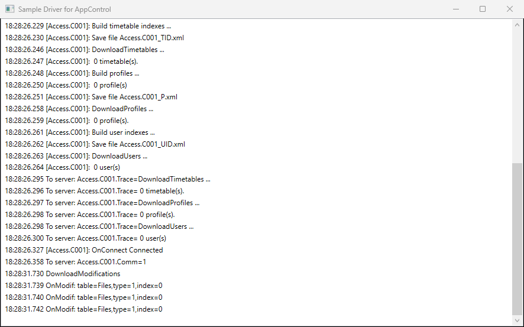

# DriverAppControl — Driver for an access controller fed by AppControl

**Used for:** integrating a third-party **access controller** (door controller, reader concentrator) with AppVision.
The access rights are managed in **AppControl**, the access control module of AppVision (people, badges, access
profiles, timetables, holidays). The driver downloads them to the controller, keeps the controller up to date when
they change, and reports badge reads, door states and the connection status to AppVision.

**Audience:** C# developers who know [DriverAdvanced](../DriverAdvanced/README.md) and integrate an access control
hardware. The communication with the controller itself is a stub (`ChannelService`): this sample shows the AppVision
and AppControl side.

**References:** `appSDK.dll`, `appData.dll`, `appCommon.dll`, `AppControl.Sdk.dll` (`Prysm.AppControl.SDK.Datalayer`),
and the OData client DLLs `Microsoft.Data.*` / `System.Spatial` 5.8.4 (NuGet packages of `packages.config`, the
same version as in the AppVision `Bin` folder). **Output:** `DriverAppControl.exe`.

**Documentation:** *Writing a driver*, `http://<server>/doccsharp/html/fa685819-4ff4-4c40-81ba-4172e43de86b.htm`,
and *Access control*, `http://<server>/doccsharp/html/04bcc881-e1bf-4e10-bb05-ea4adf6f91ea.htm`, in the API help
served by your server (URLs relative to your server, see [Documentation](../README.md#documentation)).

---

## How it works

| File | Role |
|---|---|
| `MainWindow.xaml.cs` | Trace window; starts the `Driver`; *Ctrl + close* stops it |
| `Driver.cs` | Protocol level: connection, one `Device` per controller, event queue, commands, modifications |
| `Device.cs` | Controller level: own thread, command queue, full and incremental download, data classes |
| `ChannelService.cs` | Communication with one controller: **stubs to replace** (they simulate a success) |
| `Notes.txt` | Notes on the re-indexing of the downloaded data |

### Threads

`Driver.Main` runs on its own thread. The SDK events (`StateChanged`, `Download`) and the device events are pushed
into a `ConcurrentQueue` and processed by this thread, so the AppVision calls are made from one place. Each `Device`
also runs its own thread, with a queue of commands (`SendCommand`), so that a slow controller does not block the
others. The window only displays the trace (`Dispatcher.BeginInvoke`).

### From AppControl to the controller

| Trigger | SDK | Driver |
|---|---|---|
| Full download requested in AppVision | `AppServerForDriver.Download(varNames, parameter)`; `varNames` = controllers, `parameter` = `Holidays,Timetables,Rights,Parameters` | `Device.Download`: holidays, timetables, access profiles, users, parameters |
| AppControl data modified (person, badge, rights, timetable, holiday, controller variable) | `AppServerForDriver.NewModification` | `Driver.DownloadModifications` (at most every 5 s): reads the modification log with `Datalayer.GetLastModifications(lastId)` and sends `Device.DownloadList` the people, timetables and settings to update |

The rights of the people on the readers of a controller come from AppControl:

```csharp
var dl = new Datalayer(Driver.Server);
PersonMapRight[] rights = dl.GetAllPeopleMapByReaderNames(readerNames).Result;           // everybody
PersonMapRight right = dl.GetPersonMapByReaderIds2(dl.GetVariableIds(readerNames), id).Result; // one person
```

`PersonMapRight.TimetableMap` has one entry per reader (timetable id, 0 = no access, and validity dates). The driver
groups the identical maps into **access profiles**, and re-indexes timetables and users with the ids of the controller
(`DeviceIndex`, saved in `{controller}_TID.xml`, `{controller}_UID.xml` and `{controller}_P.xml`, in the `Param`
folder of the configuration: the driver must run on the server machine). A person gets one entry per badge of the
badge type `BADGETYPE`, or one entry with the PIN code only. Inactive or expired people are not downloaded.

They replace the synchronous `GetPeopleMapByReaderNames` and `GetPersonMapByReaderNames`, now obsolete. The driver
thread has no synchronization context, so waiting for the `Task` with `.Result` is safe there (never do it on a UI
thread).

`Driver.Download` can be tested from a client or server script:

```csharp
Server.ProtocolManager.SendDownload(new[] { "Access.C001" }, "Holidays,Timetables,Rights");
```

### From the controller to AppVision

| Event of the controller (`Device`) | Variable written by `Driver` | SDK call |
|---|---|---|
| Connection state (`ConnectChanged`) | `<controller>.Comm` | `VariableManager.Set` (0 Unknown, 1 Connected, 2 Disconnected, 3 Fault, 4 Downloading) |
| Badge read (`AccessControlEvent`) | `<controller>.Reader01` .. `Reader04` | `VariableManager.SetBadge(name, badgeCode, format, ReaderStatus, personId, date)` |
| Door state / mode (`InputChanged`) | `<controller>.DoorN.Status`, `<controller>.DoorN.Mode` | `VariableManager.Set(name, value, info, null, date)` |
| Trace / error (`TraceEvent`) | `<controller>.Trace` | `VariableManager.Set` with severity -1 for a trace, 1 for an error (alarm if the variable is an alarm) |

`Device.ReadEvents` is the place where the events of the controller are read (todo in the sample).

### From AppVision to the controller

The driver subscribes to `$V.<controller>.*.Cmd` (the command variables of each controller). A change of
`Access.C001.Door1.Cmd` is sent to the device `Access.C001` as `CommandAction { Name = "Door1.Cmd", Value = ... }`
(`Device.ProcessCommandAction`, todo).

### Errors

`SendInfo` raises an alarm (`AlarmManager.AddAlarm2`) or an event (`EventManager.AddEvent`) in the group
`AppControl`. Download errors of a controller are reported in `<controller>.Trace`. An error of the modification
download does not stop the driver.

### Stop and restart

`ControllerManager.Closed` (AppVision stops the protocol) ends the main loop: devices stopped, `AppServer.Close()`,
window closed. `ControllerManager.Restart` (raised by the SDK when the connection to the server is lost) does the
same, then tries to reconnect once; if the server is still unreachable the driver ends, and AppVision relaunches it
if the protocol is *Autostart*. This reconnection in the same process differs from DriverSimple and DriverAdvanced,
which exit on `Restart` and let the server relaunch the protocol; exiting is the simpler choice for a new driver.

---

## Step 1 — Configure AppVision

1. **Protocols › Add**: *Name* e.g. `AccessCtrl`, *Manager* `DriverAppControl.exe`. *Timeout* and *Retries* are
   passed to each `ChannelService`.
2. **Variables**, for each controller (the names below are the ones the code builds):

```
Access.C001               Node     Source: $P.AccessCtrl
                                   Address: address of the controller
                                   Parameters: BADGETYPE=1   (badge type downloaded, default 1)
                                               PASSWORD=...  (read by ChannelService)
Access.C001.Comm          Enum     0 Unknown, 1 Connected, 2 Disconnected, 3 Fault, 4 Downloading
Access.C001.Trace         String
Access.C001.Reader01..04  Reader   the readers: AppControl rights are given on them
Access.C001.Door1.Status  Integer or Enum
Access.C001.Door1.Mode    Integer or Enum
Access.C001.Door1.Cmd     Logical/Integer, Command checked
```

3. In **AppControl**, give access rights on the readers (access profiles, timetables) to a few people with badges.

---

## Step 2 — Build and run

1. Build the project. The output goes to `bin\Debug\` (or `bin\Release\`) in the project folder. Copy `DriverAppControl.exe` and its `.config` into the
   AppVision `Bin` folder, or set the *Manager* of the protocol to the absolute path of the built exe.
2. Start the protocol (Configurator › Protocols › *Start*), or from Visual Studio with the command line argument
   `AccessCtrl` (`AccessCtrl@hostname`; protocol stopped in AppVision).
3. The window shows `Connection success.`, then for each controller `Start thread ...` and `OnConnect Connected`;
   `Access.C001.Comm` becomes 1.
4. Send a download (script above): the window shows `DownloadHolidays ...`, `DownloadTimetables ...`, the profiles and
   the users; the index files appear in the `Param` folder of the configuration.

   

5. Modify a person or a badge in AppControl: after a few seconds, `OnModif: table=Apc_People...` and the download of
   that person.

> Production drivers go to `Bin\Drivers\<name>\appDriver<name>.exe` with an `AssemblyResolve` handler: see
> [DriverAdvanced](../DriverAdvanced/README.md).

---

## How to adapt this sample

1. Implement `ChannelService` with the protocol of the controller (TCP, serial, vendor SDK), and set
   `MAX_READER`, `MAX_HOLIDAY`, `MAX_TIMETABLE`, `MAX_USER`, `MAX_PROFILE` in `Device.cs` to its capacities.
2. Fill `DeviceTimetable` with the timetable format of the controller (constructor from `Timetable`).
3. Implement `Device.ReadEvents` (badge reads, door states) and `Device.ProcessCommandAction` (door commands).
4. Adjust the variable names built in `Driver.OnInputChanged`, `OnAccessControlEvent`, `OnConnectChanged`.

---

## Troubleshooting

| Symptom | Cause |
|---|---|
| "Usage: DriverAppControl.exe protocolName[@hostname]" | No command line argument. |
| "No variable connected to this protocol" | No controller node has its *Source* set to `$P.<protocol>`. |
| The download sends no user | The readers are not variables of type **Reader** named `<controller>.Reader01..04`, nobody has rights on them, or the badges are not of the type `BADGETYPE`. |
| `Download: ...` exception in the trace | The AppControl data service failed (AppControl not licensed, not reachable, or timeout on a large site). |
| Index files not written | The driver does not run on the server machine (the `Param` path comes from the server). |
| The window cannot be closed | Intentional: *Ctrl + close*, or stop the protocol from AppVision. |

Log file of the driver: `%ProgramData%\<installation folder>\LogFiles\<year>\<product>\<protocol>_<yyMM>.log`
when the driver runs from the AppVision `Bin` folder (*Log files* button of the server window); `%ProgramData%\bin\`
when it runs from its own `bin\Debug` with copies of the DLLs.

---

## See also

- [DriverAdvanced](../DriverAdvanced/README.md) — template of a driver: devices, cache, logging, deployment.
- [WebServiceODataAppControl](../WebServiceODataAppControl/README.md) — AppControl people and badges over OData.
- [AppControlSynchro](../AppControlSynchro/README.md) — import of people into AppControl.
