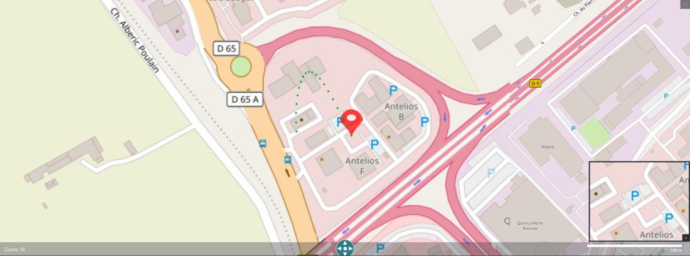
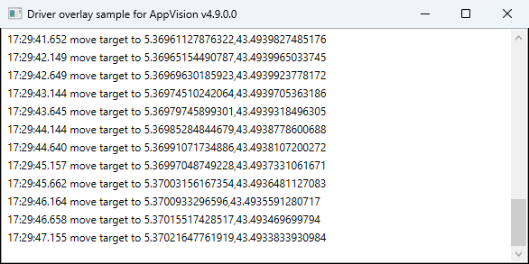

# DriverOverlay — Move icons on a map from a driver

**Used for:** showing live positions (vehicles, people, assets, alarms located by a sensor) on the geographical
synoptics of AppVision. The driver creates **overlays**: graphical items placed by the server on top of synoptics,
without modifying the synoptics. This sample moves a target along a Lissajous figure and leaves a 20-dot trail.

**Audience:** C# developers who know the connection sequence of [DriverMinimal](../DriverMinimal/README.md).

**Available with:** the *synoptic overlay* license option of the AppVision server (otherwise overlays are silently
ignored).

**References:** `appSDK.dll` (`AppServerForDriver`, `ClientManager`), `appCommon.dll` (`Helper`), `appData.dll`
(`OverlayItem`). **Output:** `DriverOverlay.exe`.

**Documentation:** *Writing a driver*, `http://<server>/doccsharp/html/fa685819-4ff4-4c40-81ba-4172e43de86b.htm`,
and *Synoptics and symbols*, `http://<server>/doccsharp/html/0d5e00d8-27bb-4b55-a9b4-bfcf867794da.htm`, in the API
help served by your server (URLs relative to your server, see [Documentation](../README.md#documentation)).





---

## How it works

1. The driver connects as the protocol given on its command line, calls `StartNotifications` (needed to receive the
   *Close* command of AppVision, even without variable subscription) and `ProtocolSynchronized`.
2. It removes the trail left by a previous run, then a `DispatcherTimer` ticks every 500 ms.
3. At each tick it computes a position in metres around an origin (Aix-en-Provence, France), converts it to longitude
   and latitude, and calls `ClientManager.UpdateOverlay`:

```csharp
// create or move the target: same id at each call
_appServer.ClientManager.UpdateOverlay("target", "DriverOverlay\\target.xaml", "@geo", location);

// trail: a new id at each step, shown on one synoptic only, the oldest dot is removed
_appServer.ClientManager.UpdateOverlay("tail_" + step, tailSymbol, "DriverOverlay\\map.xaml", location);
_appServer.ClientManager.RemoveOverlay("tail_" + (step - 20));
```

4. When the window closes, the driver removes its overlays, then closes the connection.

### UpdateOverlay parameters

| Parameter | Meaning |
|---|---|
| `name` | Id of the overlay, unique on the server. Same id = the overlay is updated (moved, symbol changed). |
| `symbol` | What to draw: a symbol of the configuration (path relative to `Param\Client`, here `DriverOverlay\target.xaml`), or a XAML string (the green dots of the trail). |
| `synoptic` | Where: a synoptic of the configuration (`DriverOverlay\map.xaml`), or `@geo` for every geographical synoptic. |
| `position` | `System.Windows.Point`: X = longitude, Y = latitude (WGS-84 decimal degrees) on a geographical synoptic; pixels on a plain synoptic. |
| optional | `symbolParameters` (parameters `%1`... of the symbol), `parameters`, `layers`, `symbolZoomLevel`. |

`UpdateOverlay`, `RemoveOverlay` and `GetOverlays` return a `Task`: the sample sends the moves without waiting.

### Overlay lifetime

Overlays are kept by the **server**, not by the driver: they stay on the maps after the driver stops, and every client
that opens the synoptic sees them. Remove them when they are no longer valid. Remove them **by id**: the sample lists
its own overlays with `GetOverlays("Name=tail_*")` and removes each one with `RemoveOverlay(id)` (a mask passed to
`RemoveOverlay` is not expanded by the 4.10 server).

### Coordinates

`Helper` converts metric offsets to degrees:

```csharp
double dLon = Helper.GetOffsetLongitude(xMeters, latitudeDegrees);   // east-west
double dLat = Helper.GetOffsetLatitude(yMeters);                      // north-south
var location = new Point(originLon + dLon, originLat + dLat);         // X = longitude, Y = latitude
```

### Threads

The timer is a `DispatcherTimer` (UI thread): no locking needed. `ControllerManager.Closed` and `.Restart` are raised
on SDK threads and go back to the UI thread with `Dispatcher.BeginInvoke` before closing the window.

---

## Step 1 — Configure AppVision

### Option A — The configuration provided with the sample

The `Configuration` folder is a complete AppVision configuration (`Param` and `Histo` databases, synoptics):

| Object | Content |
|---|---|
| Protocol | `DriverOverlay`, *Manager* `DriverOverlay.exe` |
| Synoptic `DriverOverlay\map.xaml` | geographical synoptic (OpenStreetMap tiles) centred on the origin of the trajectory |
| Symbol `DriverOverlay\target.xaml` | pin image, tooltip = position |
| Home page | link to the map, *Start* / *Stop* buttons of the protocol, warning if `DriverOverlay.exe` is missing |

It also holds objects of other samples (other protocols and variables): ignore them.

1. **Copy** the `Configuration` folder out of the repository, for example to
   `AppVision 4\Configurations\DriverOverlay` (the server upgrades and writes the databases).
2. In the **server window** (appServer), click **...** next to *Configuration*, then **Browse**, and select the copied
   folder (it must contain `Param` and `Histo`). The server restarts on it. Holding **Shift** while the server
   starts also opens this choice.
3. If a synoptic reports a compilation error, **generate** the client configuration from the configurator.

The map needs Internet access from the client to load the OpenStreetMap tiles.

### Option B — In your own configuration

1. **Protocols › Add**: *Name* `DriverOverlay`, *Manager* `DriverOverlay.exe`. No variable is needed.
2. Create a geographical synoptic `DriverOverlay\map.xaml` around longitude 5.3701, latitude 43.4935 (or change
   `_originLocation` in the code), and a symbol `DriverOverlay\target.xaml`; or change the names in the code.

---

## Step 2 — Build and deploy

1. Build the project. The output goes to `bin\Debug\` (or `bin\Release\`) in the project folder, with copies of
   the AppVision DLLs: it can run from there.
2. Copy `DriverOverlay.exe` (and `DriverOverlay.exe.config`) into the AppVision `Bin` folder, or set the *Manager* of
   the protocol to the absolute path of the built exe. The symbols and synoptics belong to the configuration, not to
   `Bin`.

> Production drivers go to `Bin\Drivers\<name>\appDriver<name>.exe` with an `AssemblyResolve` handler: see
> [DriverAdvanced](../DriverAdvanced/README.md).

---

## Step 3 — Run

1. Start the protocol: *Start* button of the home page (option A), or Configurator › Protocols › *Start*.
   From Visual Studio: stop the protocol in AppVision, then set the command line arguments to `DriverOverlay`
   (or `DriverOverlay@hostname`).
2. In a client, open `DriverOverlay\map.xaml` (link of the home page): the pin moves along a figure-eight, followed
   by green dots. The driver window lists the positions sent.
3. Stop the protocol: the pin and the dots disappear.

---

## Troubleshooting

| Symptom | Cause |
|---|---|
| Nothing on the map, no error | The license has no synoptic overlay option; or the synoptic shown is not `DriverOverlay\map.xaml` / not geographical. |
| The pin is shown but no dots | The trail is only drawn on `DriverOverlay\map.xaml`; the pin (`@geo`) is drawn on every geographical synoptic. |
| The map is grey | No Internet access for the tiles, or zoomed far from the origin (Aix-en-Provence). |
| No pin but the dots are shown | The symbol `DriverOverlay\target.xaml` does not exist in the configuration (`Param\Client`). |
| The window closes at once | Connection or login failed (server not reachable, unknown protocol). |
| Dots of a previous run stay on the map | The driver was killed: they are removed at the next start of the driver. |

---

## See also

- [OverlaySample](../OverlaySample/README.md) — create, list and remove overlays from a client application.
- [DriverSimple](../DriverSimple/README.md) — variables, alarms and events from a driver.
