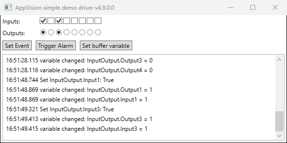
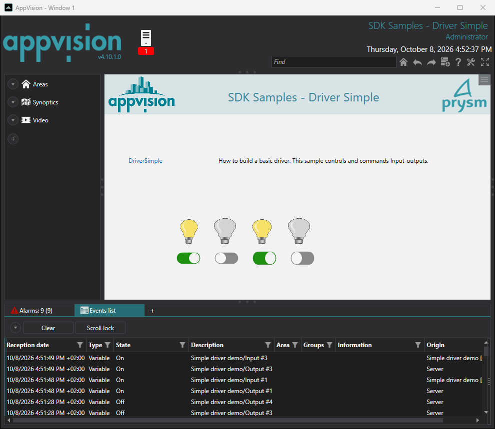

# DriverSimple — A driver with inputs, outputs, an alarm and an event

**Used for:** seeing both directions of a driver in a small WPF window: the driver writes **inputs** into AppVision
(as a device would), receives the **commands** written by AppVision, writes a **buffer**, raises an **alarm** and an
**event**.

**Audience:** C# developers who know the connection sequence of [DriverMinimal](../DriverMinimal/README.md). For the
structure of a real driver (devices, cache, logging, deployment), continue with
[DriverAdvanced](../DriverAdvanced/README.md).

**References:** `appSDK.dll`, `appData.dll`, `appCommon.dll`. **Output:** `DriverSimple.exe`.

**Documentation:** *Writing a driver* in the API help served by your server,
`http://<server>/doccsharp/html/fa685819-4ff4-4c40-81ba-4172e43de86b.htm` (URL relative to your server, see
[Documentation](../README.md#documentation)).





---

## How it works

The driver simulates a device with 8 inputs and 8 outputs. Everything is in `MainWindow.xaml.cs`.

| Window element | Direction | SDK call |
|---|---|---|
| *Inputs* check boxes | driver → AppVision | `VariableManager.Set("<node>.InputN", true/false)` |
| *Outputs* radio buttons | AppVision → driver | `VariableManager.StateChanged` for `<node>.OutputN` |
| *Set buffer variable* | driver → AppVision | `VariableManager.Set("<node>.Buffer", "12 35 2 78")` |
| *Set Event* | driver → AppVision | `EventManager.AddEvent(state, description)` |
| *Trigger Alarm* | driver → AppVision | `AlarmManager.AddAlarmExt(severity, state, description)` |
| List | — | trace of the driver, also written to the driver log file when the protocol *Log level* is above *Error* |

1. **Startup.** The protocol name comes from the command line (`protocolName[@hostname]`). After `Open` and `Login`,
   `GetVariablesByProtocol(protocolName)` returns the node whose *Source* is `$P.<protocolName>`; the driver
   subscribes to its children (`$V.<node>.*`), calls `StartNotifications` and `ProtocolSynchronized`.
2. **Initial state.** The inputs are reset with the `@init` operation:

   ```csharp
   _appServer.VariableManager.Set(node + ".Input1", 0, operation: "@init");
   ```

   `@init` updates the value without archiving it in the history and without running the server scripts
   (`VariableChanged`): use it to publish the state read at startup, not for real device events.
3. **Commands.** `StateChanged` is raised on a background thread: the handler goes back to the UI thread with
   `Dispatcher.BeginInvoke` before touching the radio buttons.
4. **Stop.** `ControllerManager.Closed` (AppVision stops the protocol) and `ControllerManager.Restart` (the SDK lost
   the connection to the server) close the window; `Window_Closed` calls `_appServer.Close()`.
   The driver does **not** relaunch itself: since AppVision 4.8.5 the server restarts a protocol by closing the
   driver and starting a new process, and it relaunches the *Autostart* protocols whose driver stopped answering.

**Values.** `Set` takes any object: the server converts it to the type of the variable (`true`/`1` for a Logical,
`"12 35 2"` or an array for a Buffer). `Set` is queued and sent by the SDK in the background: it does not throw on
network errors.

**Alarm and event parameters.** `AddAlarmExt(severity, state, description, info, areaName, groupNames, ...)`:
severity 1..100, *state* is the short text of the State column, *description* the object in alarm. The driver also
raises an alarm of severity 10 when it fails to start (`Error()`).

---

## Step 1 — Configure AppVision

Either use the ready-made configuration of the sample, or create the protocol and the variables by hand.

### Option A — The configuration provided with the sample

The `Configuration` folder is a complete AppVision configuration (`Param` and `Histo` databases, synoptics). It
contains:

| Object | Content |
|---|---|
| Protocol | `DriverSimple`, *Manager* `DriverSimple.exe` |
| Node | `InputOutput`, *Source* `$P.DriverSimple` |
| Children | `InputOutput.Input1..8`, `InputOutput.Output1..8` (Logical), `InputOutput.Buffer` (Buffer of integers) |
| Home page | 4 toggles on `Input1..4` and 4 lights on `Output1..4` |

It also holds objects of other samples (other protocols and variables): ignore them.

1. **Copy** the `Configuration` folder out of the repository, for example to `AppVision 4\Configurations\DriverSimple`:
   the server upgrades and writes the databases, keep the repository copy clean.
2. In the **server window** (appServer), click **...** next to *Configuration*, then **Browse**, and select the copied
   folder (it must contain `Param` and `Histo`). The server restarts on this configuration. Holding **Shift** while
   the server starts also opens this choice.
3. Open the configurator. If a synoptic reports a compilation error, **generate** the client configuration.
4. Check in **Variables › InputOutput.Output1** (Parameters tab) how the output is computed (*Source*); make the
   output follow the input with the expression `=$parent.Input1` if it is empty.

### Option B — By hand

```
Configurator › Protocols › Add
    Name      DriverSimple            (any name: the driver reads it from its command line)
    Manager   DriverSimple.exe        (relative to the AppVision Bin folder, or absolute path)

Configurator › Variables
    InputOutput              Node      Source: $P.DriverSimple
    InputOutput.Input1..8    Logical
    InputOutput.Output1..8   Logical   Command checked     Source: =$parent.Input1 (.. Input8) to loop back
    InputOutput.Buffer       Buffer    Buffer type: Int32
```

The node name is free: the driver finds it through its *Source*. Only the first node linked to the protocol is used.

---

## Step 2 — Build and deploy

1. Build the project. The output goes to `bin\Debug\` (or `bin\Release\`) in the project folder, with copies of
   the AppVision DLLs: it can run from there.
2. Copy `DriverSimple.exe` (and `DriverSimple.exe.config`) into the AppVision `Bin` folder, or set the *Manager* of
   the protocol to the absolute path of the built exe.

> Production drivers go to `Bin\Drivers\<name>\appDriver<name>.exe` with an `AssemblyResolve` handler: see
> [DriverAdvanced](../DriverAdvanced/README.md).

---

## Step 3 — Run and test

**Started by AppVision:** Configurator › Protocols › *Start*. The window opens, the list shows `Connected` and the
eight `Reset InputN` lines; the protocol state becomes *Synchronized*.

**Started from Visual Studio:** stop the protocol in AppVision first, then set *Project › Properties › Debug ›
Command line arguments* to `DriverSimple` (or `DriverSimple@hostname`, plus `-password=...` if the protocol has a
password).

Then:

- tick *Input1*: `InputOutput.Input1` becomes 1 in AppVision; with the loop-back expression, `Output1` follows and
  its radio button is checked;
- click a toggle of the home page (option A): the input changes in AppVision, the output and the light follow;
- *Trigger Alarm* / *Set Event*: an alarm `test - Sample Alarm` appears in the alarm list, an event `test - Sample
  Event` in the event list.

---

## Troubleshooting

| Symptom | Cause |
|---|---|
| The window closes at once | Connection or login failed: server not reachable, unknown protocol, or no node with *Source* `$P.<protocol>`. An alarm of severity 10 is raised when the login succeeded; see also the log file. |
| "Usage: DriverSimple.exe protocolName[@hostname]" | No command line argument (debugging from Visual Studio). |
| The radio buttons never change | The outputs have no *Source* expression and nobody writes them; or the variables are not children of the linked node. |
| Ticking an input changes nothing in AppVision | The child is missing or named differently (`Input1..8`, `Output1..8`, `Buffer`): the server ignores, without event, the values a driver sends to unknown variables. |
| The home page shows a warning icon | `DriverSimple.exe` is not in the AppVision `Bin` folder (Step 2). |
| Two driver windows | The protocol is started by AppVision and from Visual Studio: stop one. |

Log file of the driver: `%ProgramData%\<installation folder>\LogFiles\<year>\<product>\<protocol>_<yyMM>.log`
(*Log files* button of the server window) when the driver runs from the AppVision `Bin` folder. Run from its own
`bin\Debug`, with copies of the DLLs, it writes under `%ProgramData%\bin\LogFiles\`: the SDK names the folder after
the parent of the folder that holds `appCommon.dll`.

---

## Learning path

```
DriverMinimal  ->  DriverSimple       ->  DriverAdvanced
console, no GUI    WPF, I/O, alarms       template: devices, cache, logging, deployment
```
