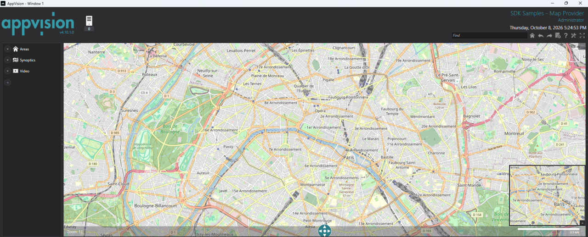

# MapProvider — A custom background map for geographical synoptics

**Used for:** learning how to write the map provider of a geographical synoptic (GIS) of AppVision: the component
of the Telerik `RadMap` control that tells where each piece (tile) of the background map comes from. The sample
reads the tiles of any **XYZ tile server** — OpenStreetMap by default, or a tile server of the site, without any key —
and keeps them in a **cache folder**, so that the map remains available when the server or the Internet cannot be
reached. It adds a settings panel to the map window of the configurator.

**Audience:** partner developers who know C# and WPF and have already created a geographical synoptic in AppVision.



---

## How it works

1. A map provider is a class derived from the Telerik `TiledProvider` (`Telerik.Windows.Controls.DataVisualization.dll`,
   shipped with AppVision). It holds one or more **tile sources** (`TiledMapSource`), and gives the projection
   (Web Mercator for every XYZ tile server).
2. The tile source turns the position of a tile (zoom level, column, row) into the **address of its image**
   (`GetTile`). RadMap downloads it, and stores it in the cache when one is set.
3. In the configurator, the synoptic background is set to the provider: the synoptic stores
   `Fill="Geo:Custom:MapProvider.dll"` and, in `MapParameters`, the settings of the provider.
4. When the synoptic is displayed, AppVision creates the **first public `MapProviderBase` type of the DLL**, then,
   as the provider implements `IConfigurable`, calls `SetConfig(MapParameters)`. In the configurator,
   `IConfigurable.GetUI()` provides the settings panel and `GetConfig()` the string to store.

| Project file | Role |
|---|---|
| `TileServerProvider.cs` | `TileServerProvider` (`TiledProvider` + `IConfigurable`) and `TileServerSource` (`TiledMapSource`) |
| `Settings.xaml(.cs)` | Settings panel: URL template, maximum zoom, cache folder; bound to the provider |
| `Configuration/` | Ready-made AppVision configuration with the synoptic `MapProvider\TileServer.xaml` (Paris) |

**References:** `appSDK.dll` (`IConfigurable`), `appCommon.dll` (`Helper`), `Telerik.Windows.Controls*.dll`, all from
the AppVision `Bin` folder with *Copy Local = False*. **Output:** `MapProvider.dll`.

**Documentation:** *Synoptics and symbols* in the API help served by your server,
`http://<server>/doccsharp/html/0d5e00d8-27bb-4b55-a9b4-bfcf867794da.htm` (URL relative to your server, see
[Documentation](../README.md#documentation)).

---

## The code

```csharp
public class TileServerProvider : TiledProvider, IConfigurable
{
	public string UrlTemplate { get; set; } = "https://tile.openstreetmap.org/{z}/{x}/{y}.png";
	public int MaxZoom { get; set; } = 19;
	public string CacheFolder { get; set; } = "";

	public override ISpatialReference SpatialReference => new MercatorProjection();

	void ApplySettings()
	{
		var source = new TileServerSource(UrlTemplate, MaxZoom);
		source.WebHeaders.Add(HttpRequestHeader.UserAgent, "...");       // tile servers ask to be identified
		MapSources.Add(source.UniqueId, source);
		if (CacheFolder != "")
		{
			CacheStorage = new FileSystemCache(Environment.ExpandEnvironmentVariables(CacheFolder));
			IsTileCachingEnabled = true;                                   // each tile is downloaded once
		}
		InheritCacheStorage(source);
	}

	public string GetConfig() => $";Url={UrlTemplate};MaxZoom={MaxZoom};Cache={CacheFolder}";
	public void SetConfig(string parameters) { /* Helper.GetParameter("Url", ...) ... ApplySettings(); */ }
}

public class TileServerSource : TiledMapSource
{
	public TileServerSource(string urlTemplate, int maxZoom) : base(1, maxZoom, 256, 256) { ... }
	public override void Initialize() => RaiseInitializeCompleted();

	protected override Uri GetTile(int tileLevel, int x, int y) =>
		new Uri(_urlTemplate.Replace("{z}", ConvertTileToZoomLevel(tileLevel).ToString()).Replace("{x}", ...)...);
}
```

- **`GetTile` receives a tile level of RadMap**, not the zoom level of the server: convert it with
  `ConvertTileToZoomLevel`.
- **Separate the settings with `;`**, not with line breaks: when the synoptic is loaded, XAML turns the line breaks
  of `MapParameters` into spaces, and the whole string would become the first value. The configurator writes
  `Username=` and `Password=` before your settings (*Authentication* of the map window), hence the leading `;`.
  `SetConfig` receives `null` when the synoptic has no parameters.
- **Name the cached tiles yourself** (`GetCachedTileName`) after the server and the tile position, so that a tile is
  found again in the next sessions and two servers never share their tiles: the sample uses `<server>_<z>_<x>_<y>`.
- **Settings in clear text.** The parameters are stored in the synoptic file: a key written there (`?key=...` in the
  URL) is readable by anyone who can read the configuration.

---

## Build, deploy and use

1. Build in **Release** and copy `MapProvider.dll` into the AppVision `Bin` folder
   (`C:\Program Files\AppVision 4\Bin`) of the **configurator** machine and of **every client** machine. Close the
   configurator and the clients before replacing it.
2. In the configurator, create or open a synoptic, select its **background** (*Fill* property) and choose the **map**
   tab (globe icon). Click `...` next to *Provider*: the map window opens.
3. In *Provider*, choose **Other**, then click `...` next to *Type* and select `MapProvider.dll` in the `Bin` folder.
   The settings panel of the provider appears: URL template (buttons for OpenStreetMap and OpenTopoMap), maximum
   zoom, cache folder.
4. Select the viewport (the area shown when the synoptic opens) and click **OK**. Save the synoptic.
5. Generate the client configuration and open the synoptic in the client.

**Sample configuration.** Copy `MapProvider\Configuration` out of the repository (e.g. to
`AppVision 4\Configurations\SDK_MapProvider`), select it in the server window and generate the client configuration
(see the [main README](../README.md#sample-configurations)). The home page links to `MapProvider\TileServer.xaml`:

```xml
<app:Synoptic Fill="Geo:Custom:MapProvider.dll" InitialZoom="13" GeoViewport="2.25,48.82,0.17,0.08" ...>
  <app:Synoptic.MapParameters><![CDATA[Url=https://tile.openstreetmap.org/{z}/{x}/{y}.png;MaxZoom=19;Cache=%LOCALAPPDATA%\AppVision SDK Samples\Tiles]]></app:Synoptic.MapParameters>
</app:Synoptic>
```

### Tile sources

| Source | URL template | Notes |
|---|---|---|
| OpenStreetMap | `https://tile.openstreetmap.org/{z}/{x}/{y}.png` | Free, for light use only (OSM tile usage policy): identify the application (User-Agent), keep the cache on, show "© OpenStreetMap contributors" on the synoptic. |
| OpenTopoMap | `https://{s}.tile.opentopomap.org/{z}/{x}/{y}.png` | Maximum zoom 17. |
| Tile server of the site | `http://tiles.site.local/{z}/{x}/{y}.png` | Map available without Internet; tiles prepared once from OpenStreetMap data (tools such as TileServer GL, MapTiler). |
| Commercial service | `https://.../{z}/{x}/{y}.png?key=XXXX` | The key is part of the URL. |

**Offline use.** With a cache folder, every tile displayed once is kept: the map keeps working on the areas and zoom
levels already seen when the tile server cannot be reached. To prepare a site that never has Internet access, browse
the useful areas once from a connected client, then copy the cache folder to the other clients, or set the URL to a
tile server of the site.

---

## Without a custom provider

The map window of the configurator already offers, without any DLL:

| Provider | `Fill` of the synoptic | Key |
|---|---|---|
| **Tile Map Service (TMS)** | `Geo:Osm:` + URL template, e.g. `https://[a-c].tile.openstreetmap.org/{z}/{x}/{y}.png` (default) | No |
| **Web Map Service (WMS)** | `Geo:Wms:` + server URL, layers in the parameters | Depends on the server |
| **ArcGIS (online)** | `Geo:arcGIS:` | Not asked (Esri services, usage terms apply) |
| **Other** | `Geo:Custom:file.dll` | Your provider |

A plain URL template works with **TMS**. Write a custom provider when the source needs more: a cache, HTTP headers, a
token to renew, a different tile scheme or projection, settings dedicated to the integrator.

---

## Troubleshooting

| Symptom | Cause |
|---|---|
| The map is empty (dark) | No access to the tile server from the client (proxy, firewall), wrong URL template, or settings separated by line breaks instead of `;` (the URL then contains the other settings). |
| *Unknown file MapProvider.dll* when the synoptic opens | The DLL is not in the `Bin` folder of this client. |
| The settings panel does not appear in the map window | The provider does not implement `IConfigurable`, or the DLL contains another `MapProviderBase` type first. |
| The settings are lost after reopening the synoptic | `GetConfig` and `SetConfig` do not use the same keys. |
| The cache folder stays empty | Folder not writable by the Windows user of the client, or `IsTileCachingEnabled` not set. |
| *Could not load file or assembly Telerik...* | The project references Telerik DLLs other than those of the AppVision `Bin` folder. |

**Debugging:** attach Visual Studio to `appConfig.exe` (map window) or `appClient.exe` (synoptic) and set breakpoints
in `SetConfig` and `GetTile`.

---

## See also

- [OverlaySample](../OverlaySample/README.md) — symbols placed by program on synoptics and geographical maps
- [DriverOverlay](../DriverOverlay/README.md) — a driver that moves geo-referenced overlays
