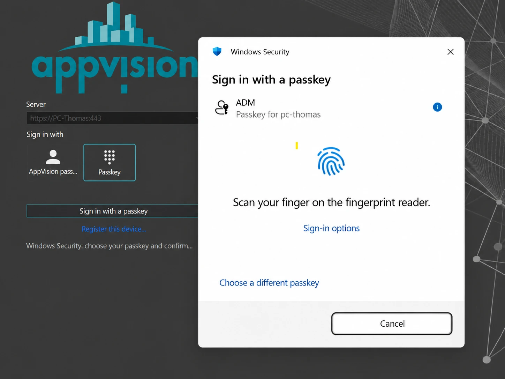

# PasskeyAuthentication — Sign in with a passkey

**Used for:** letting AppVision users sign in **without a password**, with a passkey (WebAuthn / FIDO2): Windows Hello face,
fingerprint or PIN, a USB or NFC security key, or a phone. The sample is a complete **authentication plugin**: the server part
is the WebAuthn relying party (challenges, signature checks, public keys), the client part is the sign-in tile of appClient and
appConfig, both in one DLL. It also shows how any third-party authentication method plugs into AppVision 4.10.2: method naming,
multi-step login through a single session, second factor exemption, configurator page.

**Audience:** C# developers who integrate AppVision with a site's authentication policy. Server-side code runs inside
`appServer.exe`, client-side code inside `appClient.exe` and `appConfig.exe` (Windows 10 1903 or later for the WebAuthn API).

**Available in:** AppVision 4.10.2 and later (`IServer.CheckUserPassword`, method naming by file, `TwoFactor.ExemptMethods`).



---

## How it works

```
appClient / appConfig                                      appServer.exe
PasskeySignIn (ISignInPlugin)                              PasskeyAuth (IAuthPlugin)

Register this device (once per device, RegisterDialog)
  Login(Step=RegisterBegin, Username, Password, Device) ─▶  CheckUserPassword(Username, Password, Method=ProofMethod)
                                                            challenge kept for this session
                        ◀─ 401 "Passkey:Create:{rpId, user, challenge, excludeCredentials}"
  Windows Security dialog: WebAuthNAuthenticatorMakeCredential
  Login(Step=RegisterFinish, ClientData, Attestation) ───▶  checks clientDataJSON, authenticator data, key algorithm
                                                            Passkeys.json += public key ; e-mail to the user
                        ◀─ session opened for the AppVision account

Sign in
  Login(Step=Begin [, Username]) ─────────────────────────▶  challenge kept for this session
                        ◀─ 401 "Passkey:Get:{rpId, challenge, allowCredentials}"
  Windows Security dialog: WebAuthNAuthenticatorGetAssertion
  Login(Step=Finish, ClientData, CredentialId,
        AuthenticatorData, Signature, UserHandle) ────────▶  signature checked with the stored key, counter updated
                        ◀─ session opened
```

| File | Role |
|---|---|
| `PasskeyAuth.cs` | Server plugin: `IAuthPlugin` (the four steps), `IAuthClientInfo` (the sign-in tile), `IAuthProbe` (state in appConfig), `IAuthAccountPlugin` (opens an existing account). Challenges per session, options. |
| `WebAuthn\WebAuthnVerifier.cs` | Relying party checks of WebAuthn Level 2 § 7.1 and § 7.2: clientDataJSON, rpIdHash, flags, signature, counter. |
| `WebAuthn\CoseKey.cs` | COSE public keys (RFC 8152): ES256 (P-256, DER signature converted to r‖s) and RS256. |
| `WebAuthn\AuthenticatorData.cs`, `WebAuthn\Cbor.cs` | Authenticator data layout and a 100-line CBOR decoder: no dependency to add to the AppVision `Bin` folder. |
| `PasskeyStore.cs` | `Param\Server\Passkeys.json`: the public keys, one entry per device, written atomically. |
| `PasskeyProtocol.cs` | What the two plugins exchange: step names, 401 message prefixes, options DTOs, base64url, JSON helpers. |
| `PasskeySignIn.cs` | Client plugin: the tile (one button, a link to the registration dialog) and the ceremony driver; `RegisterDialog`, a `ChildWindow` of appCommon. |
| `WindowsWebAuthn.cs` | P/Invoke of `webauthn.dll` (version 1 structures): make credential, get assertion, error names. |
| `web\Passkey.js` | Web client part: an ES module the web client loads from the server, the browser does the ceremony (`navigator.credentials`). |

**References** (*Copy Local = False*, the DLL is loaded from the AppVision `Bin` folder): `appSDK.dll` (`IAuthPlugin`,
`ISignInPlugin`, `IServer`), `appData.dll` (`UserRow`, `AuthenticationMethodInfo`), `appCommon.dll`, `appScript.dll`
(`ScriptServerBase.Server`), `System.ServiceModel.Web` (`WebFaultException`). **Output:** `appPluginPasskey.dll`.

**Documentation:** the authentication plugin interfaces (`Prysm.AppVision.SDK.Plugins.Auth`) are not described in the
API help, and the types added by 4.10.2 (`IAuthClientInfo`, `IAuthProbe`, `IAuthAccountPlugin`,
`AuthenticationMethodInfo`) do not exist before AppVision 4.10.2: this README is their documentation. The help lists the
samples on its *SDK samples* page, `http://<server>/doccsharp/html/1f39c0dc-edd7-4d7c-9dd1-ddc315b457df.htm` (URL
relative to your server, see [Documentation](../README.md#documentation)).

---

## An authentication plugin in AppVision 4.10.2

- **The method is named after the file.** `appPlugin<Name>.dll` in the `Bin` folder is the method `<Name>`: `appPluginPasskey.dll`
  is **`Passkey`**, the name used by `App.Main.Authentication.Methods`, the `Method=` login argument, the
  `App.Main.Authentication.Passkey.*` options and `TwoFactor.ExemptMethods`. `IPlugin.Name` is only the label of the configurator
  grid. A DLL with another name is written as `x.dll` or `x.dll#Type` in the options, and keeps that string as its name.
- **One DLL, two plugins.** `PasskeyAuth : IAuthPlugin` runs in the server, `PasskeySignIn : ISignInPlugin` in the clients.
  `IAuthClientInfo.Describe()` tells the clients which tile to show (`Ui = Plugin`, `ClientPlugin = "appPluginPasskey.dll"`) and
  hands them public parameters (`RpId=`, `Origin=`) through `ISignInPlugin.SetConfig`. Never a secret: `Hello` needs no session.
- **Several `Login` calls, one session.** The server adds `SessionId=` to the arguments of every `Login`: the plugin keeps the
  challenge under that key (two minutes, single use). To send the challenge, the plugin throws a
  `WebFaultException<string>(message, HttpStatusCode.Unauthorized)`: a `FaultException` goes through the server untouched, the client
  gets a `Prysm.AppVision.Common.HttpRequestException` with `StatusCode = 401` and the raw message, and nothing is written in the
  events. The client answers with the next step on the same `AppServer`.
- **The client plugin calls the server itself.** `ISignInPlugin.Login(args)` receives the arguments it raised with `OnLogin` and
  calls `AppServer.Login(args)`; `Method=Passkey` is added by the SDK when the tile is not the default method. Keep those calls on
  the UI thread: appClient hands a 401 to the thread that called, a call made from `Task.Run` would not see it. Only the Windows
  API runs on a worker thread, so the dispatcher keeps running behind the Windows Security dialog.
- **Open the session of an existing account.** The plugin implements the marker `IAuthAccountPlugin`: it proves the possession
  of an AppVision account, like the client certificate, instead of being a directory. Returning the `UserRow` of that account
  (with its `Id`, read by `UserManager.GetUserByName`) opens its session, a local account included; the server reloads the record
  by its `Id` and ignores the rest of the object, and never creates an external account (a row without `Id` is refused). Without
  the marker, a plugin that returns a local account is refused as a directory homonym (`Local_user_exists_x`). The parameter
  `AuthMethods=` of the user or profile and the account availability (locked, validity, timetable) are checked as for any method.
  The marker requires AppVision 4.10.2: the DLL does not load on an older server.
- **Proof of identity at registration.** `IServer.CheckUserPassword(NameValue[])` runs the sign-in pipeline for the password
  (failure counter and profile lockout, locked or expired account refused, an event for every check) with the method the plugin
  names: `Method=` is required here because the default method may be the plugin itself. The method is the option
  `App.Main.Authentication.Passkey.ProofMethod` (`Local` by default, `AD` or `LDAP` on a directory site).
- **Second factor.** A passkey with user verification (face, fingerprint, PIN) already is two factors: the server requires the
  `UV` flag, and the method is exempted from the AppVision second factor by `App.Main.Authentication.TwoFactor.ExemptMethods`
  (the *2FA* column of the configurator, unticked). Without the exemption, a profile that requires the second factor gets the
  code prompt after the passkey.
- **Refusals.** A refusal is sent the same way as a challenge, as a 401 with a readable message: brute force on a signature is not
  a threat, so the sample does not make them count as failed logins (an ordinary exception would, but reaches the client as an
  internal error). The password check at registration does count, through `CheckUserPassword`.

### What the server verifies

`WebAuthnVerifier` follows the relying party steps of the specification, reduced to what a desktop client needs:

| Check | Registration | Sign-in |
|---|---|---|
| `clientDataJSON.type` | `webauthn.create` | `webauthn.get` |
| `clientDataJSON.challenge` | the challenge of this session, once | same |
| `clientDataJSON.origin` | option `Origin` (default `https://<RpId>`) | same |
| `rpIdHash` | SHA-256 of `RpId` | same |
| Flags | UP and **UV** present, AT present | UP and **UV** present |
| Key | ES256 or RS256, stored as COSE | signature over `authenticatorData ‖ SHA-256(clientDataJSON)` |
| Counter | stored | must grow when the authenticator counts (clone detection) |
| User handle | SHA-256 of the user id, sent to the authenticator | must match the account of the credential |

Not verified: the **attestation statement** (format `none` requested, any format accepted). A site that trusts only some
authenticator models checks the attestation certificate chain against the FIDO metadata in `VerifyRegistration`. In production,
a library such as Fido2NetLib can replace `WebAuthn\`; check its target framework against the AppVision `Bin` first (version 4
targets .NET 8 only).

### The web client

The web client knows no plugin when it ships: for a method `Ui = Plugin` it loads at run time the ES module named by the
`WebModule=` parameter of `Describe()` (a path relative to the server, here `/authplugins/Passkey.js`), or `/authplugins/<Method>.js`
when the parameter is absent. The server serves every file of `Bin\Web` as is. A method whose module is missing or invalid is not
offered by the web client. The module has no build step and no dependency; it exports its form and the ceremony
(contract `apiVersion: 1`):

```js
export default {
    apiVersion: 1,
    unavailable: ctx => window.isSecureContext ? null : 'HTTPS required',     // reason shown instead of the form, or null
    signIn: { label: { en: 'Sign in with a passkey', fr: '...' }, icon: 'fas fa-fingerprint', fields: [], run: signIn },
    actions: [{ label: { en: 'Register this device' }, help: { en: '...' },
                fields: ['username', 'password', { name: 'device', label: { en: 'Name of this device' }, optional: true,
                                                   value: 'Windows – Google Chrome' }], run: register }],
};
```

The web client adds the server version to the URL (`?v=`), so that browsers do not keep the module of a previous version in their
cache; a plugin updated on its own changes the URL it publishes (`WebModule=/authplugins/Passkey.js?v=2`).
A field of the plugin may be `optional` (the label says so) and carry a proposed `value` the user can change; `'username'` and
`'password'` are the fields of the sign-in screen. `run(ctx)` opens the session or throws an `Error` whose message is shown. `ctx` gives `method` (the published
`AuthenticationMethodInfo`), `parameter(name)`, `values` (`username`, `password` and the plugin fields), `language`, and the two calls
of the ceremony: `ctx.login(args, continuation)` sends the first `Login` on a new session with `Method=<method>`, the user name and
password typed, and `args`; `ctx.continueLogin(args, continuation)` sends the next one on the same session. When the refusal starts
with `continuation` (`Passkey:Get:`), the promise returns the rest of the message and the session stays pending; any other refusal
rejects it and the web client handles it (refusal message, second factor dialog). The web client keeps the sign-in warning, the
second factor, the error display and the opening of the application.

The browser checks what Windows does not: the relying party id must be the host name of the web client URL (or a registrable suffix
of it), and the origin it writes in `clientDataJSON` is the page origin. Set `App.Main.Authentication.Passkey.RpId` to the DNS name
the users type and `Origin` to `https://<that name>[:port]`: appClient and appConfig read the same values, so a passkey registered on
a workstation (Windows Hello) also signs in from the browser of that workstation. Chrome and Edge refuse a single-label name
(`pc-01`: *'rp.id' cannot be used with the current origin*) and an IP address: use the fully qualified name (`pc-01.example.com`),
the default, or `localhost` for a test on the server itself. The HTTPS certificate of the server must be trusted and name that host:
browsers disable WebAuthn on a site with a certificate error.

### The Windows API

`WindowsWebAuthn` calls `webauthn.dll` as a browser does. The application builds `clientDataJSON` itself (type, challenge,
origin), Windows hashes it, shows its dialog, talks to the authenticator and returns the attestation or the assertion. The
relying party id is any string for a desktop application: the server enforces `rpIdHash` and the origin itself, which is why both
are published to the clients. `RequireResidentKey` is set: the passkey is a *discoverable credential*, so a user can sign in
without typing a name (Windows lists the accounts of the relying party). Windows 11 adds the phone (QR code) and third-party
passkey managers to the dialog without any change in the application.

---

## Install

1. Build the project: `bin\Debug\appPluginPasskey.dll` (or `bin\Release\`).
2. Copy `appPluginPasskey.dll` into the AppVision `Bin` folder (`C:\Program Files\AppVision 4\Bin`) of the **server** and of the
   **client and configurator workstations**: the sign-in tile is loaded from the same DLL. For the web client, copy
   `web\Passkey.js` into `Bin\Web\authplugins` on the server (HTTPS required). Restart the server, the clients and the
   configurator.
3. Configurator › **Options › Authentication**: tick **Active** on the *Passkey* row and untick its **2FA** column (a passkey is two
   factors). Keep *AppVision password* active and default at first: the users register their passkey with their password. The
   row writes `App.Main.Authentication.Methods = Local;Passkey` and `App.Main.Authentication.TwoFactor.ExemptMethods = ...;Passkey`.
4. Options of the method, Configurator › **Options** (all optional):

   | Option | Default | Role |
   |---|---|---|
   | `App.Main.Authentication.Passkey.RpId` | fully qualified name of the server | Relying party id the passkeys are bound to. Set it to the DNS name the clients use, with a domain (browsers refuse a single-label name); changing it later orphans every passkey. |
   | `App.Main.Authentication.Passkey.Origin` | `https://<RpId>` | Origin signed in `clientDataJSON`. |
   | `App.Main.Authentication.Passkey.ProofMethod` | `Local` | Method that checks the password at registration (`AD`, `LDAP`... on a directory site). |
   | `App.Main.Authentication.Passkey.MaxPerUser` | `5` | Passkeys per account. |

5. On a client: choose the **Passkey** tile, click **Register this device...**, type the user name, the AppVision password and a
   device name, **Register**: Windows asks for the face, fingerprint, PIN or security key, then the session opens. Next time,
   **Sign in with a passkey** alone: Windows lists the passkeys registered for the relying party on this device (discoverable
   credentials), plus the phone and security key options, and the server opens the session of the account the chosen passkey
   belongs to. A client that knows the account may send `Username=` with `Step=Begin`: Windows then only offers the passkeys of
   that account (`allowCredentials`) and the server refuses one of another account; an unknown name gets an empty list, like no
   name at all, so the server does not reveal which accounts have a passkey. The server writes `Passkeys.json` in
   `Configurations\<config>\Param\Server`:

```json
{ "credentials": [ { "user": "ADM", "id": "5wDRlH1OMUUZu-_ZzL-zObKOEVWXJRsI_jc70HSZXSM", "publicKey": "pQECAyYgASFYIP...",
                     "signCount": 1, "name": "PC-THOMAS", "created": "2026-10-18T10:56:33Z", "aaguid": "nd0YF69aRnKiuT492VAAqQ" } ] }
```

To revoke a passkey, delete its entry (the file is read at each sign-in). The user gets an e-mail at every registration
(`UserRow.Email`, SMTP options of the server) so that a registration they did not make is noticed.

Server log on a test server (`Configurator › Options › Authentication` shows the state *Relying party 'pc-thomas', origin
'https://pc-thomas', identity proved by 'Local' at registration*):

```
Controller: StartAuthentification: default=Local methods=Local;Passkey fallback=Admin
Controller: AddEvent UserLogin Identity checked Administrateur          <- CheckUserPassword at RegisterBegin
Passkey: ADM registered 'PC-THOMAS' (ES256), session opened
Controller: AddEvent UserLogin Login Administrateur
Passkey: ADM signed in with 'PC-THOMAS'
Passkey: registration refused for ADM: Invalid byte encoding.            <- malformed attestation (REST test)
```

Negative cases checked with the REST web service (`OpenExt` + `Login`, no authenticator): `Step=Begin` answers 401
`Passkey:Get:{...}`; `Step=Finish` without a pending challenge, or replayed from another session, answers 401 *no pending
challenge for this session*; a wrong password at `RegisterBegin` answers 401 `Login:Invalid_user_password` after an *Identity
check failed* event; a password login through the method answers 401 *sign in with a passkey*.

---

## Troubleshooting

| Symptom | Cause |
|---|---|
| No *Passkey* tile on the sign-in screen | The DLL is not in the client `Bin`, or the method is not active on the server (`StartAuthentification` line of the server log). |
| *Passkeys need Windows 10 1903 or later* | `webauthn.dll` is missing: older Windows. |
| *Windows Hello is not set up on this computer* | Settings › Accounts › Sign-in options; a security key or a phone still works. |
| *Refused by Windows Security: no matching passkey...* | The passkey was registered against another `RpId`, or on another Windows account, or revoked in `Passkeys.json`. Register the device again. |
| *registration refused, clientData: origin ...* | `Origin` option changed, or the client got stale parameters: restart the client. |
| *signature counter ... possible cloned authenticator* | The same credential was used from a copy, or the authenticator's counter was reset. Revoke and register again. |
| *Invalid user or password* at registration | The password check through `ProofMethod` failed: wrong password, locked account, or `ProofMethod` names a method that is not active. The event log has the reason. |
| Code prompt after the passkey | The method is not in `TwoFactor.ExemptMethods` (2FA column ticked) and the profile requires the second factor. |
| Locked out | Sign in with the *AppVision password* tile (or `-method=Local` on the command line), or remove `Passkey` from `App.Main.Authentication.Methods`. |

---

## Learning path

```
ClientSimple  ->  PasskeyAuthentication
SDK client        authentication plugin: server part (who may sign in) + client part (how they sign in)
```
