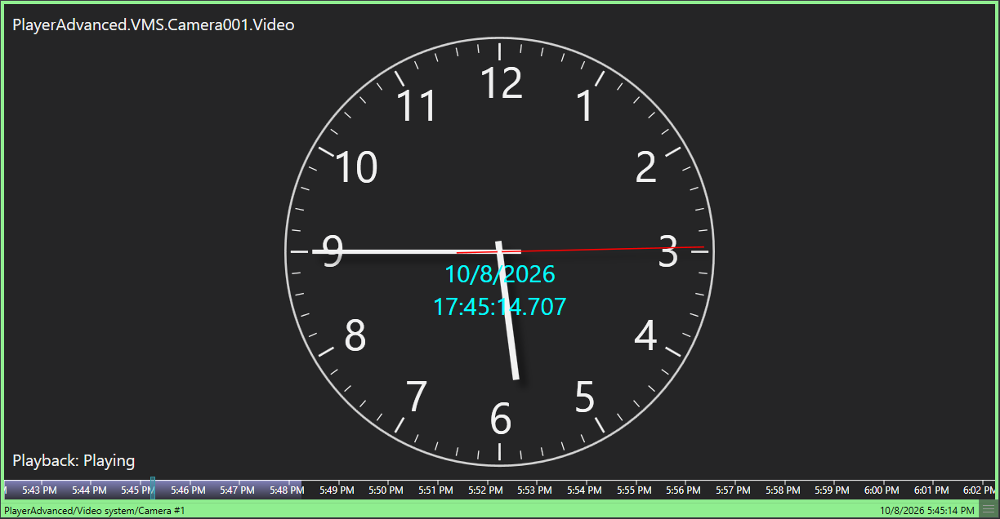

# PlayerAdvanced — A complete video player: live, playback, PTZ, export

**Used for:** integrating a video system (VMS, NVR, camera SDK) in the AppVision client with all the player features:
live, recorded video with speed and step-by-step, PTZ and presets, focus, video export.

The player of this sample renders a **clock** instead of decoding video, so that it runs without any camera: the
clock shows the time of the "frame", the PTZ commands move and zoom it, the focus blurs it. Replace the clock with
your SDK's video control and the simulated delays with real calls.

**Audience:** partner developers who know C# and WPF, and have read [PlayerSimple](../PlayerSimple/README.md).



---

## How it works

A player is a WPF control that derives from `PlayerBaseControl` (`appVideo.dll`). The interfaces it implements tell
AppVision what it can do, and the tile shows the matching buttons:

| Interface | Feature | Main members |
|---|---|---|
| `IPlayerLive` | Live | `Play()`, `Play(stream)`, `GetStreams()`, `Pause()`, `Resume()`, `Snapshot()`, `StretchVideo` |
| `IPlayerPlayback` | Recorded video | `Play(start, duration, speed)`, `Stop()`, `Pause()`, `Resume()`, `StepForward()`, `StepBackward()`, `PlaybackSpeed`, `PlaybackPosition`, `CanBackward`, `CanGoByStep`, `GetVideoSequences()`, `AddBookmark()` |
| `IPlayerPtz` | Pan, tilt, zoom | `ContinuousMove(pan, tilt)`, `ContinuousZoom(zoom)`, `AbsoluteMove()`, presets, patterns, `Focus()`, `Iris()`, `CanXxx` properties |
| `IPlayerExport` | Video export | `Export(start, end, folder, fileName)`, `CancelExport()`, `ExportProgress` event, `ExportConfig` |

All interfaces derive from `IPlayerVideoDevice`: `Connect(cameraName, address, parameters)`, `Disconnect()`, `Status`.
`PlayerBaseControl` implements every member with a default behaviour ("not available", `false`, empty list):
override only what your video system supports, and the `CanXxx` properties that enable the buttons.

| Project file | Role |
|---|---|
| `PlayerClockControl.xaml(.cs)` | The player: the four interfaces |
| `Clock.xaml(.cs)` | Analog clock used as a fake video image |
| `Configuration/` | Ready-made AppVision configuration (see [PlayerSimple](../PlayerSimple/README.md#try-it-with-the-sample-configuration)) |

**References:** `appVideo.dll`, `appSDK.dll`, `appCommon.dll` (AppVision `Bin` folder).
**Output:** `PlayerClock.dll` (assembly name, namespace `PlayerClock`, class `PlayerClockControl`).

---

## Lifecycle

```
Connect(cameraName, address, parameters)     camera shown in the tile
  Play()                                      live
  Play(start, duration, speed)                playback (returns false if nothing is recorded)
  Pause() / Resume() / StepForward() ...      operator commands
  Stop()                                      end of the live or of the playback
Disconnect()                                  tile closed or other camera
```

- `Connect` can be called again on the same instance for another camera: reinitialise everything there.
- The **player knows its mode**: `Play()` starts the live, `Play(start, ...)` a playback. The sample keeps it in a
  `PlayerMode _mode` field. (`PlayerBaseControl.Mode` is obsolete: it reads the host control.)
- `Status` (*Connecting*, *Connected*, *Playing*...) is set by AppVision; the player raises its progress with
  `FireFrameDecoded(timestamp)` for each frame: the tile switches to *Playing* and, in playback, the timeline follows
  the timestamp (local time).
- `SetError(message, seconds)` displays an error in the tile, `SetText(message, seconds)` an information.

---

## Playback

```csharp
public override async Task<bool> Play(DateTime start, TimeSpan duration, double speed)
{
	await Stop();
	PlaybackSpeed = speed;                // negative = backward
	_date = start;
	_playbackEnd = duration == TimeSpan.Zero ? (DateTime?)null : start + (speed > 0 ? duration : -duration);
	_mode = PlayerMode.Playback;
	_fakeVideo.Start();
	return true;                          // false = no recording at this date
}

public override bool CanBackward => true;     // enables backward playback
public override bool CanGoByStep => true;     // enables the step buttons
```

`GetVideoSequences(from, to)` (not implemented here) returns the recorded ranges, bookmarks and locked sequences, so
that the timeline can show them. `AddBookmark` and `VideoLock` forward the operator's bookmarks and locks to the
video system.

---

## PTZ

Speeds go from -1000 to 1000, 0 = stop. Positive pan = right, positive tilt = **up** (the *up* button of the
AppVision PTZ control sends `ContinuousMove(0, 500)`), positive zoom = zoom in.

```csharp
public override bool CanContinuousMove => true;
public override bool CanPresets => true;
public override bool CanFocus => true;

public override Task ContinuousMove(double panSpeed, double tiltSpeed) { ... }
public override Task<string[]> GetPresets() => Task.FromResult(_presets.Keys.ToArray());
public override Task GotoPreset(string preset) { ... }
```

A capability you cannot provide can still be overridden to explain why, as `SetHomePosition()` does here with
`SetError(...)`.

---

## Export

AppVision runs an export on a **separate instance** of the player, in a hidden window: it calls `Connect`, then
`Export(start, end, folder, fileName)`, without `Play`. Report the progress from 0 to 100 with `FireExportProgress`;
the export job is shown as completed when the progress reaches 100.

```csharp
public override async Task Export(DateTime start, DateTime end, string filePath, string fileName)
{
	for (double i = 0; i < 100; i++)
	{
		await Task.Delay(50);               // a real player writes the file here
		FireExportProgress(i, "");
		if (_cancelExport) throw new OperationCanceledException();
	}
	File.WriteAllText(Path.Combine(filePath, Path.ChangeExtension(fileName, ".txt")), "...");
	FireExportProgress(100, "");            // done
}
public override void CancelExport() => _cancelExport = true;
```

`ExportConfig` can return an `IConfigurable` whose `GetUI()` adds your own options (format, password...) to the export
window; `SetConfig` receives them before `Export`.

---

## Build, deploy and declare

1. Build in **Release** and copy `PlayerClock.dll` into the AppVision `Bin` folder of every client machine
   (`C:\Program Files\AppVision 4\Bin`). Close the clients before replacing it.
2. In the configurator, on the camera variable (type *Camera*) or on its video system node, set the parameter:

   ```
   CreateControlPlayer=PlayerClock.dll
   ```

   The sample configuration declares the camera `PlayerAdvanced.VMS` this way, with the address
   `user:pwd@10.11.12.13` (parsed by `Connect` with `Helper.ParseUri`, never contacted).

A video system can split its features over several DLLs. All these parameters are read on the camera variable and its
parents:

| Parameter | Use |
|---|---|
| `CreateControlPlayer` | **Required.** Player used for the live (and for playback, PTZ and export unless declared below). `file.dll` or `file.dll#Namespace.Class`. |
| `CreatePlaybackPlayer` | Separate player for playback and export. |
| `CreatePtzPlayer` | Separate PTZ controller (`IPlayerPtz`). |
| `CreateOverlayPlayer` | Metadata provider drawn over the video (`IPlayerOverlay`, see [PlayerMetadata](../PlayerMetadata/README.md)). |
| `Live.Address`, `Playback.Address` | Address given to the live / playback player instead of the *Address* field. |
| `Ptz.Address`, `Overlay.Address` | Address given to a separate PTZ / overlay player (they do not receive the *Address* field). |
| `Live.xxx`, `Playback.xxx`, `Ptz.xxx`, `Overlay.xxx` | Parameters given to one player only, without the prefix. As soon as one `Live.` (or `Playback.`) parameter exists, that player receives only the prefixed parameters. |

---

## Troubleshooting

| Symptom | Cause |
|---|---|
| A button is missing in the tile (step, backward, presets, focus...) | The matching `CanXxx` property returns `false`. |
| *Not available* when clicking a button | The method is not overridden: the `PlayerBaseControl` default is used. |
| The export never ends in the export jobs list | `FireExportProgress(100, ...)` is not called at the end of `Export`. |
| The timeline does not move in playback | `FireFrameDecoded(timestamp)` is not called, or the timestamp is not in local time. |
| *Unknown file PlayerClock.dll* | The DLL is not in the `Bin` folder of this client machine. |

**Debugging:** attach Visual Studio to `appClient.exe` and set breakpoints in the overrides. Each override calls
`this.DebugWriteLine()` (`Prysm.AppVision.Common`), which traces the method name; the bottom of the image shows the
mode and the status of the player.

---

## Learning path

```
PlayerSimple   ->  PlayerAdvanced                    ->  PlayerMetadata
live only          live, playback, PTZ, export           overlay drawn over the video (object detection)
```
