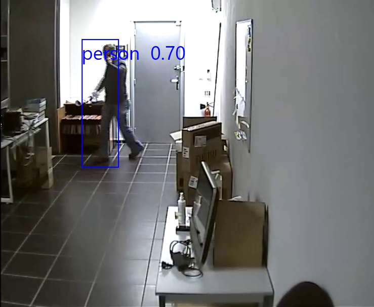

# PlayerMetadata — Draw metadata over the video (object detection)

**Used for:** displaying information **over** the video of a camera, independently of the player that shows the video:
analytics results (bounding boxes, licence plates, line crossing), heat maps, zones, texts...
This sample runs an object detection neural network (Tiny YOLOv2, with ONNX Runtime) on the video and draws a box
and a label around each detected person, car, bicycle...

**Audience:** partner developers who know C# and WPF, and have read [PlayerSimple](../PlayerSimple/README.md).



---

## How it works

1. A **metadata provider** is a plain class (not a control) that implements `IPlayerOverlay` (`appVideo.dll`).
2. It is declared on the camera variable with `CreateOverlayPlayer=PlayerMetadata.dll`, **next to** the video player
   declared with `CreateControlPlayer` (any player: an AppVision player or your own).
3. Once the live video is displayed, AppVision calls `Connect(cameraName, address, parameters)` with the
   `Overlay.Address` parameter of the camera, then `Play(canvas)`. The provider draws WPF shapes on this `Canvas`,
   which AppVision lays over the video and scales with it.
4. When the tile is closed or shows another camera: `Disconnect()`.

To keep the demonstration self-contained, this provider **decodes the video a second time** with its own off-screen
FFmpeg decoder and runs the detection on these frames. A real provider receives its metadata from the video system or
the analytics server (ONVIF metadata stream, VMS SDK events...) and only draws them.

The two decoders are not synchronised: the boxes can be a little behind the image, and after a few loops of the demo
video they no longer match it (reload the camera to start again). Metadata that carries the timestamp of its frame
does not have this problem.

| Project file | Role |
|---|---|
| `PlayerMetadata.cs` | `IPlayerOverlay` implementation: decode, detect, draw |
| `TinyYoloDetector.cs` | The detection itself (not specific to AppVision): prepares the image, runs the model, reads the boxes |
| `packages.config` | NuGet package `Microsoft.ML.OnnxRuntime` (managed wrapper and native `onnxruntime.dll`) |
| `Configuration/` | Ready-made AppVision configuration, with the demo video `Param\Client\PlayerMetadata\intrusion.avi` |

**References:** `appVideo.dll`, `appSDK.dll`, `appFFmpeg.dll`, `appCommon.dll`, `appData.dll` (AppVision `Bin`
folder), `Microsoft.ML.OnnxRuntime` (NuGet). **Output:** `PlayerMetadata.dll`, plus the files listed below.

`appFFmpeg.dll` (`Prysm.AppVision.FFmpeg.FFmpegVideoPlayerCtrl`) is a different component from the `App.FFmpeg.dll`
(`Prysm.FFmpeg.Next`) used by [PlayerSimple](../PlayerSimple/README.md); both ship in the `Bin` folder, and neither is
described in the API help.

**Documentation:** *Video players* in the API help served by your server,
`http://<server>/doccsharp/html/241bd2a4-bd41-4dfa-aa02-ecbd33f83103.htm` (URL relative to your server, see
[Documentation](../README.md#documentation)).

**Model:** `tinyyolov2-8.onnx` of the [ONNX Model Zoo](https://github.com/onnx/models) (Tiny YOLOv2, Pascal VOC: 20
classes such as person, car, bicycle, dog), downloaded by the first build. Any other ONNX model can replace it: only
`TinyYoloDetector.cs` depends on its input and output.

---

## The `IPlayerOverlay` interface

```csharp
public interface IPlayerOverlay : IPlayerVideoDevice   // Connect, Disconnect, Status, StatusChanged...
{
	Task Play(Canvas drawingCanvas);                   // live: start drawing on this canvas
	Task Play(Canvas drawingCanvas, DateTime start);   // playback from this date
	DateTime PlaybackPosition { set; }                 // playback: timestamp of the frame displayed, for each frame
}
```

In playback, AppVision sets `PlaybackPosition` with the timestamp of each displayed frame: a provider that stores
its metadata draws those of this instant. This sample supports the live only (`Play(canvas, start)` clears the canvas).

---

## Key points of the code

**Keep the constructor light.** AppVision creates the provider while it creates the video player: an exception in the
constructor prevents the camera from being displayed at all, whereas an exception in `Connect` is only reported as an
*Overlay* error in the tile. The model (63 MB) is therefore loaded in `Connect`, on a thread-pool thread.

**Resolve the address.** `Overlay.Address` is a relative path inside the configuration (`PlayerMetadata\intrusion.avi`),
which the client downloads from the server, or an absolute path or URL:

```csharp
url = address.Contains("://") || System.IO.Path.IsPathRooted(address)
	? address
	: Sdk.Server.Hostname + "Config/Param/Client/" + address.Replace('\\', '/');   // Hostname ends with '/'
```

**Draw on the UI thread, compute elsewhere.** Frames arrive on the UI thread, where the frame is resized to the input
of the model (416 x 416) and copied. The detection runs with `Task.Run`, one at a time (frames arriving meanwhile are
skipped) and at most 3 per second; the drawing happens back on the UI thread:

```csharp
var items = await Task.Run(() => engine.Detect(pixels, width, height));   // about 50 ms on a recent CPU
if (canvas != drawingCanvas) return;          // stopped or moved meanwhile
canvas.Children.Clear();
canvas.Width = width; canvas.Height = height; // canvas in video pixels: AppVision scales it over the image
foreach (var item in items) { /* Rectangle + TextBlock at item.X, item.Y */ }
```

**Release native resources.** `Disconnect` stops the decoder, waits for the running detection, then disposes the
detector (native memory of ONNX Runtime). An `async void` event handler catches its exceptions: one escaping would
crash the client.

**Use the DLLs of the AppVision `Bin` folder.** ONNX Runtime needs `System.Memory`, `System.Buffers`,
`System.Numerics.Vectors` and `System.Runtime.CompilerServices.Unsafe`. AppVision ships them: the project references
them with *Copy Local = False*, so that the deployment never replaces the versions of the product. As AppVision 4.10
ships a later `Unsafe` than the one `System.Memory` asks for, without binding redirect in `appClient.exe.config`,
`TinyYoloDetector` gives it the version of the `Bin` folder through `AppDomain.AssemblyResolve`. The same applies to
any library of your provider that depends on these assemblies.

**Report a status.** `Status` and `StatusChanged` belong to `IPlayerVideoDevice`: return a real value, never throw.

---

## Build and deploy

The ONNX Runtime native DLL is 64-bit: AppVision clients run in 64-bit.

1. Build in **Release**. The first build restores the NuGet package and downloads the model (63 MB) into
   `obj\model\`; without Internet access, copy `tinyyolov2-8.onnx` there by hand.
2. Copy into the AppVision `Bin` folder (`C:\Program Files\AppVision 4\Bin`) of every client machine, from
   `bin\Release`:

   | File | Origin |
   |---|---|
   | `PlayerMetadata.dll` | this project |
   | `Microsoft.ML.OnnxRuntime.dll` | NuGet `Microsoft.ML.OnnxRuntime.Managed` |
   | `onnxruntime.dll`, `onnxruntime_providers_shared.dll` | NuGet `Microsoft.ML.OnnxRuntime` (native, x64) |
   | `tinyyolov2-8.onnx` | the model, downloaded by the build |

3. The **Microsoft Visual C++ Redistributable 2015-2022 x64** must be installed on the client machines (required by
   `onnxruntime.dll`; it is often already there).

The model file is searched next to `PlayerMetadata.dll` (`AppDomain.CurrentDomain.BaseDirectory`).

---

## Declare it in the configurator

On the camera variable (type *Camera*):

| Field | Value |
|---|---|
| Address | `PlayerMetadata\intrusion.avi` (the video played by the main player) |
| Parameters | `CreateControlPlayer=appPlayerGeneric.dll`<br>`CreateOverlayPlayer=PlayerMetadata.dll`<br>`Overlay.Address=PlayerMetadata\intrusion.avi` |

- `CreateControlPlayer` can be any player; `appPlayerGeneric.dll` is the AppVision generic FFmpeg player.
- `Overlay.Address` and the parameters starting with `Overlay.` are the only ones given to the provider.
- The parameter `ShowMetadata` (`Hidden`, `Live`, `Playback`, `Visible`; default `Visible`) of the camera chooses
  when the metadata layer is shown.

The sample configuration (see [PlayerSimple](../PlayerSimple/README.md#try-it-with-the-sample-configuration) for how
to open it) declares the camera `PlayerMetadata.Analytics` this way; its home page has a button that opens it.

---

## Troubleshooting

| Symptom | Cause |
|---|---|
| The video plays but no box appears | Look at the *Overlay* error of the tile, or attach the debugger: missing `Overlay.Address`, model file not found, ONNX Runtime not loaded. |
| *Overlay: Unable to load DLL 'onnxruntime'* | `onnxruntime.dll` is not in the `Bin` folder, or the Visual C++ Redistributable x64 is not installed. |
| *Overlay:* error naming `tinyyolov2-8.onnx` | The model is not in the `Bin` folder. |
| *Overlay: The type initializer for 'PerTypeValues`1' threw an exception* | `System.Runtime.CompilerServices.Unsafe` could not be loaded in the version asked for: see *Use the DLLs of the AppVision Bin folder* above. |
| Boxes are shifted compared to the video | The canvas is not sized like the video frame (`Width`/`Height` in pixels), or, in this sample only, the second decoder is out of step with the player (reload the camera). |
| The client becomes slow | Detection on CPU: reduce the rate (333 ms in the sample), or use an execution provider of ONNX Runtime for the GPU (DirectML, CUDA). |

**Debugging:** attach Visual Studio to `appClient.exe`. The number of detected items and the inference time of each
frame are written with `Debug.WriteLine`.

---

## See also

- [PlayerSimple](../PlayerSimple/README.md) — a minimal live player
- [PlayerAdvanced](../PlayerAdvanced/README.md) — live, playback, PTZ, export, and the list of player parameters
- [OverlaySample](../OverlaySample/README.md) — overlays positioned by the server on synoptics, maps and cameras
