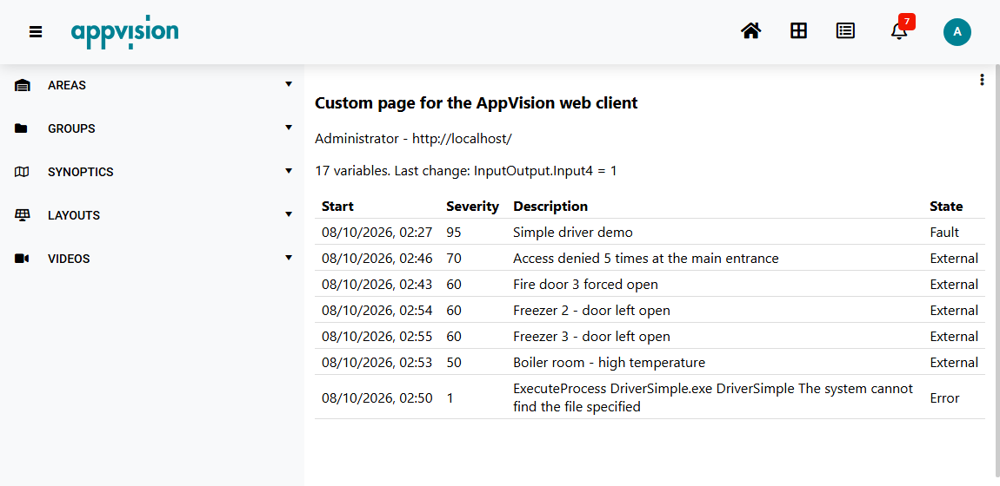

# WebCustomClient — Custom page in the AppVision web client (React + TypeScript SDK)

**Used for:** adding your own web page to the AppVision web client: a dashboard, a business form, a view of an
external system... The page runs inside the web client and reuses its connected session through the TypeScript SDK
(`@prysm/appsdk`): no second login, live data (variables, alarms, users...) and navigation in the web client.

**Available in:** AppVision 4.9 and later (web client at `http://<server>/webapp/`).

**Audience:** web developers who know React and TypeScript. The same technique works with any framework or with plain
JavaScript: only `window.parent.sdk` matters.

**Documentation:** *Web services and JavaScript SDK* in the API help served by your server,
`http://<server>/doccsharp/html/11442ac1-c309-4c8f-8837-050c0cf5fe13.htm`, and the reference of the JavaScript SDK,
`http://<server>/docjs/index.html` (URLs relative to your server, see [Documentation](../README.md#documentation)).



---

## How it works

1. The AppVision web client is a single-page application served by the AppVision server. Once logged in, it exposes
   its SDK objects on its window: `window.sdk.server` (`AppServer`, connected, caches kept up to date by
   notifications) and `window.sdk.client` (`AppClient`: load a view in a container, open a window...).
2. The web client shows any document whose name is a URL (or starts with `{appserver}`, replaced by the server
   address) in an `<iframe>`.
3. The custom page reads `window.parent.sdk.server`. The browser only allows it when the page has **the same origin**
   as the web client: the page must be served by the AppVision server itself, from `Bin\Web`.

| File | Role |
|---|---|
| `src/App.tsx` | Gets the host `AppServer`, shows the user, the variable count, the last variable change and the current alarms (live). |
| `src/index.tsx`, `src/*.css`, `public/index.html` | React entry point and styles. |
| `sdk/prysm-appsdk-4.9.76.tgz` | The TypeScript SDK package, referenced by `package.json` (see [The SDK package](#the-sdk-package)). |
| `.env.production` | `PUBLIC_URL=/CustomControl/`: the URL path where the build is deployed. |
| `WebCustomClient.esproj` | Visual Studio JavaScript project (`npm start`, `npm run build`). |

The SDK is only imported **as types** (`import type`): at run time all calls go to the objects of the web client,
so the bundle does not contain the SDK and the page does not open any connection of its own.

```typescript
const server: AppServer | undefined = (window.parent as any).sdk?.server;   // undefined outside the web client

const refresh = () => setAlarms([...server.alarmManager.getAlarms(20)]    // current alarms, from the cache
  .sort((a, b) => b.Severity - a.Severity));                               // (a copy: never sort the cache)
refresh();
const sub = server.alarmManager.alarmsChanged.subscribe(refresh);          // then on each change
...
return () => sub.unsubscribe();   // the subjects belong to the web client: always unsubscribe
```

---

## Build and deploy

**Prerequisites:** Node.js 16 or later (tested with Node 20 / npm 9), an AppVision server with its web client, a
user allowed to use the web client (test bench: `ADM` / `123`).

```bash
cd WebCustomClient
npm ci            # install the dependencies of package-lock.json
npm run build     # -> build/, URLs prefixed with /CustomControl/
```

1. Copy the **content** of `build/` to `C:\Program Files\AppVision 4\Bin\Web\CustomControl\` on the AppVision server
   (folder names starting with `AppVision` or `AppControl` are reserved). To use another folder, change
   `PUBLIC_URL` in `.env.production` and rebuild.
2. Check `http://<server>/CustomControl/` answers: alone, the page shows *No AppVision session*, which is expected.
3. Show it in the web client, for example:
   - **Home page:** `http://<server>/AppVision?homepage=/CustomControl/` opens the web client (after login) with the
     page as home page; add `&restricted=1` to hide the header and side bar.
   - **From the browser console** of the web client (F12), or from your own code:
     ```javascript
     sdk.client.load({ containerName: 'main', document: { name: '{appserver}/CustomControl/' } });
     sdk.client.open({ title: 'Custom page', width: 800, height: 500, document: { name: '{appserver}/CustomControl/' } });
     ```
   - Anywhere the web client accepts a document name (container of a web environment, synoptic command), use
     `{appserver}/CustomControl/`.
4. The page shows the connected user, the server address, the number of variables, the last variable change and the
   table of current alarms, updated live.

`npm start` serves the page at `http://localhost:3000` for layout work only: it is not inside the web client, so it
shows *No AppVision session*. Test the SDK part with the build deployed in `Bin\Web`.

---

## The SDK package

`@prysm/appsdk` is the TypeScript SDK of AppVision, the one the web client itself is built with.

- **This repository** ships version 4.9.76 as a package file, `sdk/prysm-appsdk-4.9.76.tgz`, declared as
  `"@prysm/appsdk": "file:sdk/prysm-appsdk-4.9.76.tgz"` in `package.json`: `npm ci` works offline and the build is
  reproducible. Types are imported from the package root: `import type { AppServer, AlarmRow } from '@prysm/appsdk'`.
- **The version matching your server** is served by the server itself (AppVision MCP Server extension), without any
  account or package feed:
  ```bash
  curl http://<server>/mcp/sdk                                   # manifest: version, size, sha512 integrity, install command
  curl -o sdk/prysm-appsdk-<version>.tgz http://<server>/mcp/sdk/prysm-appsdk-<version>.tgz
  ```
  Save the `.tgz` in `sdk/`, update the file name in `package.json`, then `npm install`. Prefer this `file:` reference
  to the server URL (`npm i http://<server>/mcp/sdk/...`), which would tie `package-lock.json` to one server.
- **Versions.** Inside the web client, the package only provides the types: the objects come from the web client of
  the server. A page that opens its own session (below) runs the package code: SDK 4.9.79 and later require an
  AppVision 4.10.2 server, so take the version that your server serves.

For a page **outside** the web client (another site, Node.js), the SDK can open its own session:

```typescript
const server = new AppServer();
await server.login({ host: 'http://<server>', username: 'ADM', password: '123', productName: 'MyApp' });
server.startKeepAlive();
```

The browser applies CORS in that case: serve the page from `Bin\Web`, or from a web server acting as a reverse proxy
to AppVision, so that the page and `/AppVisionService.svc` have the same origin. The raw HTTP calls behind the SDK
are shown in [WebServiceREST](../WebServiceREST/README.md).

---

## Extend the sample

```typescript
// variables (cache of the web client)
const state = server.variableManager.getStateByName('Building.Room1.Temperature');   // state.Value, state.Quality
await server.variableManager.set('Building.Room1.Setpoint', '21.5');
server.variableManager.statesChanged.subscribe(states => states.forEach(s => console.log(s.Name, s.Value)));

// alarms
await server.alarmManager.acknowledgeById(alarm.Id);
const past = await server.alarmManager.getHistoAlarms(new Date(Date.now() - 86400000), new Date());

// current user and rights
const user = server.userManager.currentUser;             // user.fullName, user.Name, user.Email
const canConfigure = server.userManager.checkRight('Configure.Option');

// scenarios
const scenario = server.scenarioManager.getRows().find(s => s.Name === 'Night');
if (scenario) await server.scenarioManager.startScenarioById(scenario.Id);

// navigation in the web client (window.parent.sdk.client)
(window.parent as any).sdk.client.load({ containerName: 'main', document: { name: 'Building.xaml' } });
```

Main members of `AppServer`: `variableManager`, `alarmManager`, `eventManager`, `areaManager`, `groupManager`,
`userManager`, `operandManager`, `scenarioManager`, `protocolManager`, `fileManager`, `videoManager`,
`overlayManager`, `peopleManager` / `badgesManager` / `visitorManager` (AppControl), `http` (raw HTTP service,
`http.host`), `isConnected`, `connectionLost`.

---

## Troubleshooting

| Symptom | Cause |
|---|---|
| *No AppVision session* inside the web client | The page is not served by the AppVision server (other host, port or scheme than the web client): the browser blocks `window.parent`. Deploy it in `Bin\Web` and use `{appserver}/...` or a relative URL. |
| Blank page, 404 on `/static/js/...` in the console | The build was copied to another folder than `PUBLIC_URL`. Copy the content of `build/` to `Bin\Web\CustomControl\`, or change `PUBLIC_URL` and rebuild. |
| Old version still shown | Browser cache: reload the iframe with Ctrl+F5, or set the option `App.Server.WebService.CacheControl` (e.g. `no-cache`) on a development server. |
| No alarms although some exist | The user's profile filters the areas, or the page subscribed before the web client was connected (reload the view). |
| `npm ci` fails | Network access to `registry.npmjs.org` needed for the React dependencies. |

---

## Learning path

```
WebServiceREST      ->  WebCustomClient                 ->  WidgetLibrary
raw HTTP calls          web page inside the web client      WPF widgets inside the desktop client
```
