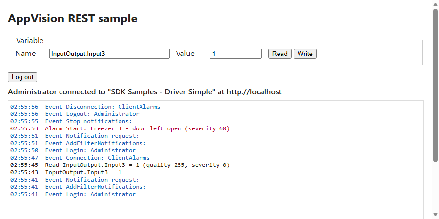

# WebServiceREST — Call the AppVision REST service from plain JavaScript

**Used for:** connecting a web page (or any HTTP client) to AppVision without the .NET or TypeScript SDK: open a
session, log in, receive live notifications (variables, alarms, events), read and write a variable, close the
session. The same sequence of HTTP calls applies from Python, Node.js, PowerShell or any other language.

**Available in:** AppVision 4.x (REST service `AppVisionService.svc`, JSON).

**Audience:** web or back-end developers who know HTTP and JavaScript; no .NET knowledge needed.



---

## How it works

| File | Role |
|---|---|
| `appServer.js` | `AppServer` class: all the REST calls (session, login, polling, `get`/`post` helpers). No DOM access: it also runs in Node.js 18+. |
| `index.html` | The page: login form, live notification log, variable read/write, logout. |
| `Web.config` | Only used by the Visual Studio *web site* project of the solution, not needed at run time. |

The REST service is at `http(s)://<server>/AppVisionService.svc/<Operation>`. Requests and responses are JSON
(`Accept: application/json`, `Content-Type: application/json` for POST bodies).

```
GET  Open?clientProductName=...&noCookie=true      -> "session-id"       (session, no login yet)
POST Login   [{"Name":"username","Value":"ADM"},{"Name":"password","Value":"123"}]
GET  GetCurrentUser, GetOption?name=App.Main.ProjectDescription
POST AddFilterNotifications  "All"                  (what to be notified of)
GET  StartNotifications?send=false
loop every 500 ms:
  GET KeepAlive                 -> number of waiting notifications (-1: session lost)
  GET GetNotifications?count=100 (when > 0)
GET  Close                                          (end of session)
```

**Session.** `Open` returns a session id. The sample sends it in a `SessionID` header on every following request
(`noCookie=true`), which is what a non-browser client has to do. Without `noCookie`, the server also sets a
`SessionID` cookie (`HttpOnly`, `SameSite=Lax`).

**Login.** The password is sent once, in the body of `Login`, never in a URL. The sample also sends an
`Authorization: Basic` header on that request only: the server reads it when authentication is delegated to Active
Directory or LDAP. Over plain `http` both are readable on the network: use `https` outside a test bench.

**Keep the session alive.** The server closes a session that stops calling `KeepAlive`. Polling every 500 ms gives
near real-time notifications; a slower period (a few seconds) is enough for a dashboard.

**Notifications.** Each item of `GetNotifications` has a `Data` field (an object or an array of objects) whose
`__type` gives the type:

| `__type` | Useful fields |
|---|---|
| `VariableState:#Prysm.AppVision.Data` | `Name`, `Value`, `Quality` (255 = good), `Severity` (> 0 = in alarm), `Date` |
| `AlarmInfo:#Prysm.AppVision.Data` | `Event` (0 Start, 1 End, 2 Update, 3 Acknowledge, 4 Report...), `Alarm.Id`, `Alarm.Description`, `Alarm.Severity` |
| `EventRow:#Prysm.AppVision.Data` | `StateDesc`, `Description`, `Date` |
| `ServerState:#Prysm.AppVision.Data` | server state (active, redundancy...) |

Also `AreaState`, `GroupState`, `ProtocolState`, `ScenarioState`, `UserState` and configuration changes
(`VariableRow`, `AreaRow`...).

`AddFilterNotifications` can be called several times to narrow what is received: `"All"`, `"$V.Building.*"`
(variables), `"$A.Area1|$A.Area2"` (areas), `"$G.Fire"` (groups).

---

## Run the sample

**Prerequisites**

- An AppVision 4.x server running, with its web service enabled on HTTP (port 80) or HTTPS (port 443): options
  `App.Server.WebService.Http` / `App.Server.WebService.Https`. Check `http://<server>/AppVisionService.svc/Hello`
  answers in a browser (no login needed).
- A user allowed to connect (test bench: `ADM` / `123`). Each session uses one client connection of the licence.
- Any recent browser.

**Serve the page from the AppVision web server.** The AppVision server also serves the static files of its
`Bin\Web` folder, on the same port as the REST service. Served from there, the page and the service have the same
origin: no CORS configuration is needed.

1. Copy `index.html` and `appServer.js` to `C:\Program Files\AppVision 4\Bin\Web\WebServiceREST\`
   (the folder name must not start with `AppVision` or `AppControl`: these paths are redirected to the web client).
2. Open `http://localhost/WebServiceREST/` (with the final `/`).
3. Log in. The status line shows `<user> connected to "<project>" at http://localhost`.
4. Change a variable, trigger an alarm or acknowledge it in an AppVision client: the lines appear in the log, newest
   on top.
5. Type a variable name (e.g. `Building.Room1.Temperature`, without `$V.`) and click **Read**, or type a value and
   click **Write**: the change comes back in the log as a notification.
6. **Log out** closes the session (`Close`); closing the tab does it too.

> **Other web servers, `file://`, Visual Studio / IIS Express.** The page then has another origin than the REST
> service and the browser applies CORS. The AppVision REST service does not answer CORS pre-flight requests, so the
> `POST` calls (`Login`...) are blocked. Serve the page from `Bin\Web` as above, or put your own web server in front
> of AppVision as a reverse proxy (same origin for the page and `/AppVisionService.svc`).

**From Node.js 18+** (no browser, no CORS), the same class works as is:

```javascript
const { AppServer } = require('./appServer.js');
const srv = new AppServer('http://localhost');
srv.onNotification = n => console.log(n.__type, n.Name ?? '', n.Value ?? '');
await srv.login('ADM', '123');
```

---

## Extend the sample

`srv.get(operation)` and `srv.post(operation, body)` add the session header and parse the JSON response.

```javascript
// read a variable (empty response if it does not exist or is filtered out for the user)
const state = await srv.get('GetVariableStateByName?name=' + encodeURIComponent('Building.Room1.Temperature'));

// write a variable (the server converts the value to the variable type)
await srv.post('SetVariableExt', [{ Name: '@name', Value: 'Building.Room1.Setpoint' }, { Name: '@value', Value: '21.5' }]);

// current alarms, acknowledge one
const alarms = await srv.get('GetCurrentAlarms?filters=');
await srv.get('AcknowledgeAlarmById?id=' + alarms[0].Id);

// event history (dates in ISO 8601)
const events = await srv.get('GetHistoEvents?minId=0&maxCount=100&dateStart=2026-10-01T00:00:00Z&dateEnd=2026-10-08T00:00:00Z');
```

| Method | Operation | Use |
|---|---|---|
| GET | `Hello` | Server information, no session needed |
| GET | `Open?clientProductName=&clientProductDescription=&noCookie=` | New session, returns its id |
| POST | `Login` | `[{Name:"username"},{Name:"password"}]`; 401 if refused |
| GET | `Close` | Close the session |
| GET | `KeepAlive` | Keep the session open; waiting notification count, -1 if the session is unknown |
| POST | `AddFilterNotifications` / `RemoveFilterNotifications` | JSON string filter |
| GET | `StartNotifications?send=false` / `StopNotifications` | Start / stop the notification queue |
| GET | `GetNotifications?count=` | Dequeue notifications |
| GET | `GetCurrentUser`, `GetOption?name=`, `GetServerState` | Session context |
| GET | `GetVariableStateByName?name=`, `GetVariableStates?indexStart=0&count=1000` | Variable values |
| GET | `GetVariables?indexStart=0&count=1000`, `GetVariablesByFilter?filters=$A.Area1&indexStart=0&count=1000` | Variable configuration |
| POST | `SetVariableExt` | Write a variable: `@name`, `@value`, optional `@info`, `@quality`, `@severity` |
| GET | `GetCurrentAlarms?filters=` | Current alarms |
| GET | `AcknowledgeAlarmById?id=` | Acknowledge an alarm (it ends only when its condition clears) |
| GET | `GetHistoEvents?...`, `GetHistoAlarms?...`, `GetHistoValues?...` | History |

The same calls are wrapped, with typed objects and caches, in the TypeScript SDK `@prysm/appsdk` used by the
[WebCustomClient](../WebCustomClient/README.md) sample.

---

## Troubleshooting

| Symptom | Cause |
|---|---|
| `Failed to fetch` / `TypeError` at login | Server not reachable at that URL, or page served from another origin (CORS, see above). Open `http://<server>/AppVisionService.svc/Hello` in the browser. |
| `Login: HTTP 401 "Login:..."` | Wrong user or password, user locked or outside its validity period, or the user is already connected and sessions are unique. |
| `Login: HTTP 402` | No client connection left in the licence. |
| `Login: HTTP 406 "Renew"` | The password must be changed first (log in once with an AppVision client). |
| `Disconnected: Session closed by the server` | `KeepAlive` not called for too long (tab in background, network), server restarted, or session closed from AppVision. Log in again. |
| Nothing appears in the log | No variable changes on the server, or the user's profile filters out the areas of the variables. |
| 404 on `http://localhost/WebServiceREST` | Use the URL with the final `/`, and check the folder is in the `Bin\Web` of the AppVision installation running the server. |
| Redirected to https | The server only accepts HTTPS: use `https://<server>/WebServiceREST/`. |

Use the *Network* tab of the browser developer tools to see each request, its headers and the server answer.

---

## Learning path

```
WebServiceREST     ->  WebCustomClient               ->  WebServiceOData
raw HTTP calls         TypeScript SDK, web client        configuration CRUD (OData)
```
