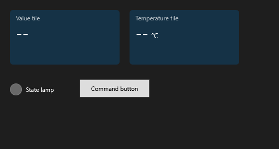
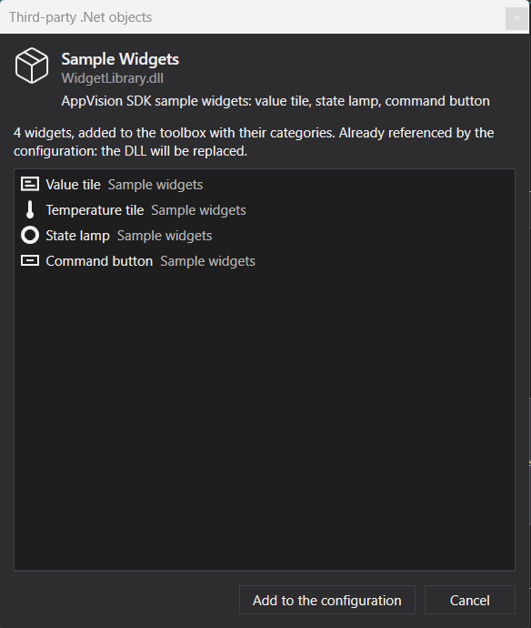
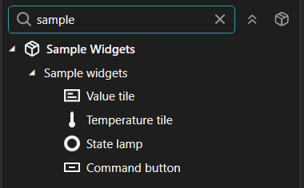

# WidgetLibrary — Create a widget DLL for the synoptic toolbox

**Used for:** delivering your own WPF controls (widgets) to AppVision integrators, so that they appear in the
toolbox of the synoptic editor like the built-in objects: in their own node, sorted by category, with an icon, a
default size and a tooltip, ready to drag onto a synoptic.

**Available in:** AppVision 4.11 and later (extensible toolbox). Earlier versions can still place the controls of
the DLL through *Third-party .Net objects*, but do not read the toolbox metadata.

**Audience:** partner developers who already configure AppVision sites (synoptics, variables, scripts) and know
the basics of C# and WPF.



---

## How it works

1. You write ordinary WPF controls in a .NET Framework 4.8 class library.
2. You describe each control with an `[AppWidget]` attribute: category, label, icon, default size, description.
   One `[assembly: AppWidgetLibrary]` attribute names the library.
3. The integrator adds the DLL to the configuration. The configurator reads the attributes **without running any
   code of the DLL**, and the library appears in the toolbox (*Objects* tab of the synoptic editor).
4. When a widget is placed on a synoptic, its public properties are written as XAML attributes. The client creates
   the control from them at run time, where the control reads and writes AppVision data through the SDK.

| Project file | Role |
|---|---|
| `Properties/AssemblyInfo.cs` | Version of the DLL and `[assembly: AppWidgetLibrary]` |
| `ValueTile.cs` | Live value of a variable; two toolbox entries for one type (`Properties`) |
| `StateLamp.cs` | Lamp following a logical or numeric variable |
| `CommandButton.cs` | Button writing a value into a variable |
| `LiveVariable.cs` | Internal helper: subscription to a variable, UI thread, clean unsubscription |

**References:** `appSDK.dll` (attributes, `Sdk.Server`), `appData.dll` (`VariableState`), `appCommon.dll`, all with
*Copy Local = False*. **Output:** `WidgetLibrary.dll`.

---

## Step 1 — Create the project

- **Class library, .NET Framework 4.8** (not .NET Core / .NET 5+): AppVision clients run on .NET Framework.
- References from the AppVision `Bin` folder, with `<Private>False</Private>`: the client already loads them, and a
  second copy next to your DLL would conflict with the installed version.
- Any C# version (`LangVersion` latest is set for the whole repository in `Directory.Build.props`).

```xml
<Reference Include="appSDK"><Private>False</Private></Reference>
<Reference Include="appData"><Private>False</Private></Reference>
<Reference Include="appCommon"><Private>False</Private></Reference>
```

---

## Step 2 — Write a widget

A widget is any public WPF element (`UserControl`, `Button`, `Control`...) with a **public parameterless
constructor**. The rules that matter:

**Settings are public CLR properties of simple types** (`string`, numbers, `bool`, enums). The synoptic stores them as
XAML attributes; the configurator lists the ones of category `AppVision` in the *Other* section of the object
properties, with their description as a tooltip.

```csharp
[Category("AppVision"), Description("Variable to display (e.g. Building.Room1.Temperature)")]
public string Variable { get; set; }
```

**Read the properties when the control is loaded, not in the constructor**: XAML sets them after construction.

**Guard every server call**: in the configurator and in the Visual Studio designer there is no connected server.

```csharp
public static bool Online => Sdk.Server is { IsConnected: true };
```

**Follow a variable** with `Sdk.Server.VariableManager`: read the current state on `Loaded`, subscribe to
`StateChanged`, unsubscribe on `Unloaded`. Notifications arrive on a background thread: go back to the UI thread
before touching the control. `LiveVariable.cs` does all of this in a few lines:

```csharp
Sdk.Server.VariableManager.StateChanged += OnStateChanged;          // Loaded
changed(Sdk.Server.VariableManager.GetStateByName(Name));           // current state
...
void OnStateChanged(VariableState state)
{
	if (string.Equals(state.Name, Name, StringComparison.OrdinalIgnoreCase))
		owner.Dispatcher.InvokeAsync(() => changed(state));            // back to the UI thread
}
```

**Write a variable** with `Sdk.Server.VariableManager.Set(name, value)` (see `CommandButton.cs`). The server converts
the value to the variable type. `Sdk.Server.OperandManager.Read / Write("$V.Node.Var")` also work, for any operand.

Never call `Open()` or `Login()` on `Sdk.Server` from a widget: the client host is already connected.

---

## Step 3 — Declare the widget for the toolbox

```csharp
[AppWidget("Sample widgets", "Value tile", Order = 10, Width = 220, Height = 110,
	IconData = "F0 M3,5 H21 V19 H3 Z M5,7 V17 H19 V7 Z M7,9 H13 V11 H7 Z M7,13 H17 V15 H7 Z",
	Description = "Live value of a variable, with a title and a unit")]
public class ValueTile : UserControl { ... }
```

| Field | Use |
|---|---|
| `category` (1st argument) | Node under the library. An AppVision label key (`Alarms`, `Video`, `Dashboard`...) is translated; any other text is shown as is. |
| `label` (2nd argument) | Name in the toolbox (translated when it is a label key). |
| `IconData` | Vector icon, WPF *path markup* (24 × 24 recommended), filled with the theme colour. Prefix `F0` for the even-odd fill rule (shapes with holes). |
| `Icon` | Image instead of `IconData`. A relative path is a *Resource* of your DLL (`Icons/tile.png`, Build Action = Resource). |
| `Width`, `Height` | Size of an object created by a simple click or by drag and drop. Without it, the object keeps its natural size (75 × 24 if it has none). |
| `Order` | Sort order inside the category (then by label). |
| `Description` | Tooltip in the toolbox and in the *Third-party .Net objects* window. |
| `Properties` | Settings applied at creation: `Name=Value;Name=Value`, converted to the property type (invariant culture). |

**One type, several entries.** `[AppWidget]` can be repeated: each occurrence is one toolbox entry. `ValueTile`
declares a second entry, *Temperature tile*, with `Properties = "Unit=°C;Format=0.0"`: same control, ready-made
settings.

**The library.** Once per DLL, for example in `Properties/AssemblyInfo.cs`:

```csharp
[assembly: AppWidgetLibrary("Sample Widgets", Description = "AppVision SDK sample widgets")]
```

Add `Icon = "Icons/library.png"` to show your logo on the library node (image as *Resource* of the DLL).

**What does not appear.** Only public, non-abstract types with a public parameterless constructor **and** an
`[AppWidget]` attribute are listed: internal helpers (`LiveVariable`), base classes and windows stay out.

> **Without referencing appSDK.** The configurator matches the attributes by their full name, not by their type.
> A DLL can declare its own `Prysm.AppVision.SDK.Widgets.AppWidgetAttribute` and `AppWidgetLibraryAttribute`
> (same namespace, same constructor `(string category, string label)`, same property names and types: `Width`
> and `Height` are `double`, `Order` is `int`, the others `string`, `AllowMultiple = true`) and be read the same way.

---

## Step 4 — Add the library to a configuration

1. Build in **Release**.
2. In the configurator, open **Synoptics**, tab **Objects**, and click the **Third-party .Net objects** button on
   the right of the search field.
3. Select `WidgetLibrary.dll`. The window shows the library and its widgets, as they will appear in the toolbox.
4. Click **Add to the configuration**. The DLL is copied into the configuration (`Param\Client`), declared as a
   reference, and the library appears at the bottom of the toolbox.
5. **Generate** the client configuration, as after any change of reference.





The reference is what makes the client compilation find the types of your DLL. Without it, the generation fails
with *The type or namespace name '…' could not be found*.

**Replacing the DLL** with a new version: repeat steps 2 to 5; the window says the DLL is already referenced and
will be replaced. Close running clients first, a loaded DLL cannot be replaced. Raise `AssemblyVersion` /
`AssemblyFileVersion` with each delivery so that a site can tell which build it runs; see the application note
*GAC and DLL version management* when several applications share a DLL.

**A DLL without attributes** (a third-party control library) can be added the same way: the window lists its
placeable types and you tick the ones to offer. They are declared in `Param\Client\Toolbox.json` (next section)
and appear under *Third-party .Net objects*.

---

## Toolbox.json — declare or adjust widgets without rebuilding

The file `Param\Client\Toolbox.json` of the configuration completes the toolbox. It has two uses:

- **declare the controls of a DLL you cannot modify** (no `[AppWidget]` attribute). The *Third-party .Net objects*
  window writes these entries when you tick controls; you can also write them by hand;
- **adjust an entry for a site** (size, label, category, icon, settings) without rebuilding the DLL, including the
  built-in objects of AppVision.

```json
{
  "widgets": [
    {
      "type": "WidgetLibrary.ValueTile, WidgetLibrary",
      "properties": "Unit=°C;Format=0.0",
      "width": 260, "height": 120
    },
    {
      "type": "Telerik.Windows.Controls.RadBarcodeQR, Telerik.Windows.Controls.DataVisualization",
      "category": "Objects", "label": "QR code", "order": 200,
      "iconData": "F0 M2,2 H10 V10 H2 Z M4,4 V8 H8 V4 Z M14,14 H22 V22 H14 Z",
      "width": 120, "height": 120, "description": "QR code of the Telerik toolkit"
    }
  ]
}
```

The first entry has the same type and the same `properties` as the *Temperature tile* entry of this sample: it only
changes its default size. The second one adds a control that has no attribute.

| Field | Use |
|---|---|
| `type` | **Required.** `Namespace.Type, AssemblyName`. The DLL must be in the configuration (`Param\Client`, declared as a reference) or in the AppVision `Bin` folder. |
| `category`, `label`, `description` | As in `[AppWidget]`. Without `category`, a new entry goes under *Third-party .Net objects*. |
| `icon`, `iconData` | Image or vector icon, as in `[AppWidget]`. |
| `width`, `height`, `order` | Default size and sort order, as in `[AppWidget]`. |
| `properties` | `Name=Value;Name=Value`, settings applied at creation. Also part of the identity of the entry (see below). |

- **An entry is identified by its `type` and its `properties`.** When it matches an existing entry (built-in object
  or library widget), it only replaces the fields it sets; otherwise it adds an entry.
- The file is read each time the synoptic editor opens, and again when a reference is added or removed.
- An invalid entry (type not found, type that cannot be created, JSON error) is ignored and logged, and a
  notification reports it in the configurator; the other entries are kept.
- Being a file of `Param\Client`, it follows the configuration: backup, restore, deployment to other sites.

---

## Step 5 — Use the widgets in a synoptic

- Drag a widget from the toolbox onto the synoptic, or click it and click on the synoptic: it is created at its
  default size, with the settings of its entry.
- Set its properties (*Variable*, *Title*...) in the *Other* section of the object properties.
- In the client, the widget follows its variable live.

**From a synoptic script.** A widget with a name (*Name* property) is a field of the synoptic, like any object, so a
client script can change its settings, for example in `OnLoaded` (see *Synoptic - OnLoaded*):

```csharp
public override void OnLoaded()
{
	Tile1.Variable = "Building.Room2.Temperature";
}
```

**In a container.** A widget can also be loaded by script into a container (see *Synoptic - Container*), with the
`file#class` syntax:

```csharp
Client.Load(0, "Container1", "WidgetLibrary.dll#WidgetLibrary.ValueTile");
```

This form loads the DLL from the AppVision `Bin` folder of each client, not from the configuration: for this use,
also copy `WidgetLibrary.dll` into `AppVision 4\Bin` on the client machines. A widget loaded this way keeps its
default property values; give it a constructor taking `params string[] args` to receive the extra arguments of
`Client.Load`.

---

## Troubleshooting

| Symptom | Cause |
|---|---|
| The library does not appear in the toolbox | The DLL is not a reference of the configuration, or none of its types carries `[AppWidget]`. Reopen the synoptic editor after adding it. |
| A widget is missing | Type not public, abstract, generic, or without a public parameterless constructor. |
| The icon is missing | `IconData` is not valid path markup, or the `Icon` image is not a *Resource* of the DLL. |
| A property is not shown in the configurator | It lacks `[Category("AppVision")]`, or it is not a public read/write property of a simple type. |
| *Type or namespace not found* when generating | The DLL is not declared as a reference: add it with *Third-party .Net objects*. |
| The widget shows `--` in the client | Wrong variable name (the `$V.` prefix is optional), or the variable has no value yet. |
| A new build is not taken into account | The client or the configurator still has the old DLL loaded: close them, then replace it. |

**Debugging:** attach Visual Studio to `appClient.exe` (*Debug › Attach to Process*) and set breakpoints in the
widget. See also the application note *Scripting - Debugging*.

---

## Learning path

```
WpfControlSimple  ->  WidgetLibrary         ->  WpfControlAdvanced
Read/Write            toolbox, live values       IPersistable, ICommandable, IContainer
```
