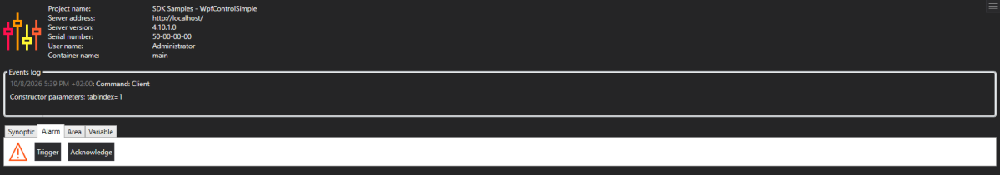

# WpfControlAdvanced — A hosted control that cooperates with the AppVision client

**Used for:** building a rich control for the AppVision client — a dedicated panel for your system, a supervision
view — that follows live data, drives the client (load a synoptic), adds its own commands to the container menu,
is saved and restored with the operator's workspace, and can be driven by synoptic scripts.

**Audience:** developers who completed [WpfControlSimple](../WpfControlSimple/README.md) (deployment and reference of
a control DLL are explained there).



| Feature | API |
|---|---|
| Server information | `GetOption`, `GetLicenseInfo`, `ControllerManager.ServerState`, `UserManager.CurrentUser` |
| Configuration data | `FileInfoManager.GetRows()` (awaited), `AreaManager.GetRows()`, `VariableManager.GetStates()` |
| Live data | `VariableManager.StateChanged`, `AlarmManager.AlarmChanged`, `EventManager.EventChanged` |
| Alarms | `AlarmManager.AddAlarm2()`, `AlarmManager.AcknowledgeAlarm()` |
| Drive the client | `Sdk.Client.Load()` |
| Host container | `IContainer` found with `GetAncestor<IContainer>()` |
| Container menu | `ICommandable` |
| Workspaces | `IPersistable` + constructor `params string[] args` |
| Called by synoptic scripts | public method `SampleFunction()` |

**References:** `appSDK.dll`, `appData.dll`, `appCommon.dll`, `appUI.dll` (AppVision `Bin` folder).
**Output:** `WpfControlAdvanced.dll`.

**Documentation:** *Synoptics and symbols*, `http://<server>/doccsharp/html/0d5e00d8-27bb-4b55-a9b4-bfcf867794da.htm`,
and *Client scripts and documents*, `http://<server>/doccsharp/html/fba94a4b-ad72-4807-be00-2d747b51da85.htm`, in the
API help served by your server (URLs relative to your server, see [Documentation](../README.md#documentation)).

---

## How it works

| File | Role |
|---|---|
| `UserControl1.xaml(.cs)` | The control: information, rolling event log, tabs *Synoptic / Alarm / Area / Variable* |
| `Configuration\` | Ready-made configuration with a synoptic that hosts the control (see below) |

### 1. Load data in `Loaded`, release in `Unloaded`

```csharp
async void UserControl_Loaded(object sender, RoutedEventArgs e)
{
    if (!Sdk.Server.IsConnected) return;                       // designer, synoptic editor
    Sdk.Server.VariableManager.StateChanged += OnStateChanged;  // balanced in Unloaded
    synoptics.ItemsSource = (await Sdk.Server.FileInfoManager.GetRows())   // server request, UI not blocked
        .Where(f => f.Type == FileInfoType.Synoptic);
    areaTree.ItemsSource = Sdk.Server.AreaManager.GetRows().Where(a => a.TreeLevel == 0); // client cache
}

void UserControl_Unloaded(object sender, RoutedEventArgs e)
{
    Sdk.Server.VariableManager.StateChanged -= OnStateChanged;
}
```

`Sdk.Server` lives as long as the client: a handler that is not removed keeps your control alive and keeps
receiving events after the synoptic is closed. `Loaded` / `Unloaded` can occur several times (tabs, containers):
subscribe and unsubscribe in pairs.

### 2. Live events and threads

The AppVision client raises the SDK events on the UI thread in its default mode, but not when it receives the
notifications through a web service port (`PortWebService` setting). The sample's `Log()` method checks
`Dispatcher.CheckAccess()` and marshals with `Dispatcher.InvokeAsync` when needed: do the same.

### 3. Alarms raised by the control

```csharp
long id = await Sdk.Server.AlarmManager.AddAlarm2(99, "My alarm", "Triggered from UserControl1"); // severity, state, description
await Sdk.Server.AlarmManager.AcknowledgeAlarm(id);
```

The alarm appears in the alarm list of every client; acknowledging it requires the corresponding user right.

### 4. `IContainer` — the host

```csharp
var container = this.GetAncestor<IContainer>(); // AppVision container displaying the synoptic (or the control)
string name = container?.Name;                   // "main", "left", ...
```

`IContainer` also gives `Document`, `Load(document, params)`, `Clear()`, layers, zoom...

### 5. `ICommandable` — commands in the container menu

When the control is the document of a container, the container menu (button at the top right corner of the
container) shows its commands:

```csharp
public Task<IEnumerable<RemoteCommand>> GetCommands() => Task.FromResult<IEnumerable<RemoteCommand>>(new[]
{
    new RemoteCommand("About WpfControlAdvanced...", "msg", "Hello!"),          // description, command, parameters
    new RemoteCommand("Sub menu", new[] { new RemoteCommand("item 1", "check1", isCheckable: true, isChecked: true) }),
});

public void ExecuteCommand(string command, string parameters) { /* "msg", "check1"... */ }
```

### 6. `IPersistable` — workspaces

Also used when the control is the document of a container. When the operator saves a workspace, the container
stores `GetEnv()`:

```xml
<document name="WpfControlAdvanced.dll#WpfControlAdvanced.UserControl1">
  <arg>tabIndex=2</arg>
  <arg>selectedVariable=InputOutput.Input1</arg>
</document>
```

When the workspace is restored, the container loads `name` again and passes the `<arg>` values to the constructor
`UserControl1(params string[] args)`. `DocumentName` / `DocumentArgs` describe the current document (the same
information) and `SetEnv()` applies a saved state. The same constructor receives the arguments of `Client.Load`:

```csharp
Client.Load(0, "main", "WpfControlAdvanced.dll#WpfControlAdvanced.UserControl1", "tabIndex=3");
```

### 7. Called by synoptic scripts

A control placed on a synoptic is a field of the synoptic, named after its *Name* (`x:Name`). The **Direct method
invoke** button of the sample synoptic runs `UserControl1.SampleFunction(999);`, which selects the next tab.

---

## Build and deploy

Same as [WpfControlSimple](../WpfControlSimple/README.md#step-1--build-and-deploy-the-dll): copy `WpfControlAdvanced.dll`
into the AppVision `Bin` folder of the server and of the clients, declare it as a reference of the client project
(**Synoptics › Add › New reference**), place `WpfControlAdvanced.UserControl1` with **Third-party .Net objects**, Generate.

To show the container features (sections 5 and 6), load the control as a document, for example from a button of a
synoptic (client script):

```csharp
Client.Load(0, "", "WpfControlAdvanced.dll#WpfControlAdvanced.UserControl1");
```

---

## Using the sample configuration (`Configuration\`)

The `Configuration` folder is a complete AppVision configuration: the home page has a **WpfControlAdvanced** link
that opens `WpfControlAdvanced\embeddedControl.xaml`, which contains:

- the control (`UserControl1`), anchored to the synoptic;
- three light bulbs bound to `$V.InputOutput.Input1..3`: click one to toggle the variable and see the change in the
  control's event log;
- the **Direct method invoke** button (section 7).

To use it: build **WpfControlSimple and WpfControlAdvanced** (the configuration references both DLLs) and copy them
into the AppVision `Bin` folder, copy the `Configuration` folder to e.g. `C:\Program Files\AppVision 4\Configurations\WpfControlAdvanced`,
then in the **AppVision server** window click `...` next to *Configuration*, **Browse**, and select it (the server
restarts and upgrades the databases). Log in with `ADM` / `123`.

---

## Troubleshooting

| Symptom | Cause |
|---|---|
| The information fields stay empty | `Sdk.Server` not connected: the control is shown in the editor or outside the client. |
| Text unreadable (white on light) with the dark theme | The control sets a fixed background but inherits the text colour of the client theme: take both from the theme, `Background="{app:RColor Key=App.Color.Panel.Background}"` and `Foreground="{app:RColor Key=App.Color.Panel.Foreground}"`, as this sample does. |
| *The calling thread cannot access this object* | A handler touched the UI from a notification thread: marshal with the `Dispatcher`. |
| The control still logs events after its synoptic is closed | A handler was not removed in `Unloaded`. |
| No custom command in the container menu | The control is on a synoptic: the menu shows the commands of the container's document, here the synoptic. Load the control itself in the container. |
| The workspace restores the control but not its state | The control has no `params string[]` constructor, or `GetEnv()` / `DocumentArgs` do not store the state as arguments. |
| **Trigger** creates no alarm / **Acknowledge** fails | The server refused the call: the reason is written in the control's log; check the rights of the operator's profile. |
| **Load** does nothing | `Sdk.Client` is null (not hosted by the AppVision client) or no synoptic is selected. |

**Debugging:** attach Visual Studio to `appClient.exe` and set breakpoints in the control. The rolling log shows
the last 15 notifications received.

---

## Learning path

```
WpfControlSimple  ->  WidgetLibrary (4.10.2)  ->  WpfControlAdvanced  ->  PlayerSimple / PlayerAdvanced
Read/write            toolbox, live values       full integration        video players
```
