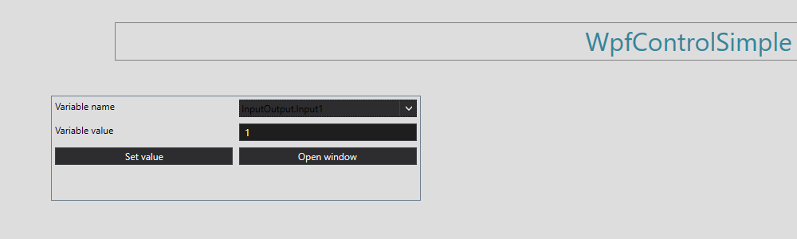

# WpfControlSimple — Your WPF control on an AppVision synoptic

**Used for:** adding your own WPF control to a synoptic (a page of the AppVision client) when the built-in objects
are not enough: a specific form, a view of another system, a custom input panel. The control runs inside the
AppVision client and talks to the server through the SDK, with the session of the logged-in operator.

**Audience:** C# / WPF developers who know how to edit a synoptic in the AppVision configurator.

The control lists the variables, shows the value of the selected one, writes a new value, and opens a copy of
itself in a floating window.



**References:** `appSDK.dll`, `appData.dll`, `appCommon.dll` (AppVision `Bin` folder).
**Output:** `WpfControlSimple.dll` — a WPF class library.

---

## How it works

| File | Role |
|---|---|
| `UserControl1.xaml(.cs)` | The control: variable list, read, write, open in a new window |
| `Configuration\` | Ready-made AppVision configuration with a synoptic that displays the control (see below) |

1. The configurator compiles the synoptics of a configuration into one assembly (the *client project*). Your DLL
   is declared as a **reference** of that project, and your control is placed on a synoptic like any object.
2. The AppVision client loads the synoptic and creates your control. `Sdk.Server` is already connected and logged
   in with the operator's account: **never call `Open()` or `Login()` in a hosted control**.
3. `Sdk.Client` gives access to the client itself (open a window, load a document in a container...).

### Reading and writing with `OperandManager`

```csharp
object value = Sdk.Server.OperandManager.Read("$V.Building.Room1.Temperature"); // from the client cache
Sdk.Server.OperandManager.Write("$V.Building.Room1.Setpoint", "21.5");         // command sent to the server
```

`Read` accepts the operands of the client scripts (`$V.` variables, `$A.` areas, `$G.` groups, `$P.`
protocols...) and returns the value held in the client cache: no server round trip. `Write` only accepts `$V.`.
To follow a value live, subscribe to `Sdk.Server.VariableManager.StateChanged` (see
[WpfControlAdvanced](../WpfControlAdvanced/README.md)).

### Opening a window with `Sdk.Client`

```csharp
Sdk.Client?.Open("WpfControlSimple.dll#WpfControlSimple.UserControl1", "Size=320,240");
```

`file.dll#Namespace.Class` creates the control from a DLL of the client's **`Bin` folder**. `Sdk.Client` is `null`
when the control is not hosted by the AppVision client (Visual Studio designer, configurator, your own application).

### Design-time guard

The control is also instantiated by the Visual Studio designer and by the synoptic editor, where the server may not
be connected: test `Sdk.Server.IsConnected` before querying it.

---

## Step 1 — Build and deploy the DLL

1. Build the project. The output goes to `bin\Debug\` (or `bin\Release\`) in the project folder.
2. Copy `WpfControlSimple.dll` into the AppVision `Bin` folder (`C:\Program Files\AppVision 4\Bin`):
   - on the **server**: the server compiles the client project and must find the DLL;
   - on **every client workstation**: the client loads it when it displays the synoptic.

   Alternative: copy the DLL into the `Param\Client` folder of the configuration on the server
   (`Configurations\<config>\Param\Client`). The compilation finds it there, and the clients download it
   automatically when they need it. The `Client.Open("file.dll#...")` syntax, however, always loads from `Bin`.
3. Close the clients and the configurator before replacing a DLL that they have loaded.

## Step 2 — Declare the reference and place the control

In the configurator, **Synoptics** page:

1. **Add › New reference**, and select `WpfControlSimple.dll` (only the file name is stored). The reference appears
   under *References* in the list of scripts. Without it, the generation fails with *The type or namespace name 'WpfControlSimple' could not be found*.
2. Open a synoptic, *Objects* toolbox, **Third-party .Net objects › `...`**: select `WpfControlSimple.dll`, then the
   type `WpfControlSimple.UserControl1`, and draw the control on the synoptic.
3. Save, then click **Generate**.

The synoptic now contains:

```xml
<ac:UserControl1 xmlns:ac="clr-namespace:WpfControlSimple;assembly=WpfControlSimple" Width="464" Height="132" ... />
```

## Step 3 — Try it

Open the synoptic in the AppVision client, select a variable, type a value, click **Set value**; click
**Open window** to open a second instance in a floating window.

---

## Using the sample configuration (`Configuration\`)

The `Configuration` folder is a complete AppVision configuration (databases `Param\Param.mdf`, `Param\AppControl.mdf`,
`Histo\Histo.mdf`, `Histo\State.mdf`, and the client files of `Param\Client`) where everything above is already done:

- the home page `homepage.xaml` has a **WpfControlSimple** link (a warning icon is shown if the DLL is missing from `Bin`);
- `WpfControlSimple\embeddedControl.xaml` contains the control;
- variables `InputOutput.Input1..8` / `InputOutput.Output1..8`, user `ADM` / `123`.

To use it:

1. Build **WpfControlSimple and WpfControlAdvanced**: the configuration references both DLLs. Copy them into the
   AppVision `Bin` folder (step 1).
2. Copy the `Configuration` folder next to your configurations, e.g. `C:\Program Files\AppVision 4\Configurations\WpfControlSimple`
   (do not run the server on the repository copy: the server modifies the databases).
3. In the **AppVision server** window, click `...` next to *Configuration*, **Browse**, and select that folder. The
   server restarts on it; the databases, saved with AppVision 4.7, are upgraded automatically.
4. Start the client and log in with `ADM` / `123`. If the client reports a generation error, check the *Errors* tab
   of the server, copy the missing DLL, and click **Generate** in the configurator (Synoptics page).

---

## Troubleshooting

| Symptom | Cause |
|---|---|
| Generation fails: *type or namespace 'WpfControlSimple' could not be found* | The reference is not declared, or the DLL is neither in the server `Bin` folder nor in `Param\Client`. |
| The control is missing on the synoptic in the client | The DLL is not in the client `Bin` folder (and not in `Param\Client`), or an exception in the constructor: attach a debugger. |
| The list is empty in the synoptic editor | Expected: no connected server at design time. |
| **Open window** does nothing | Not hosted by the AppVision client (`Sdk.Client` is null), or the DLL is not in the client `Bin` folder. |
| A new build is ignored | The client or configurator still has the old DLL loaded: close them, then copy the DLL. |

**Debugging:** attach Visual Studio to `appClient.exe` (*Debug › Attach to Process*, managed code) and set
breakpoints in the control. In the Visual Studio XAML designer the control is empty — expected.

---

## Learning path

```
WpfControlSimple  ->  WidgetLibrary (4.11)          ->  WpfControlAdvanced
Read/write            toolbox entries, live values       IPersistable, ICommandable, IContainer, live events
```
